<!-- Source: results/20261124T114542660847Z_integrated_hw_10M_20s_resume_check/analysis/extended_analysis_technical_report.md. Published snapshot; scientific numbers unmodified. -->

# Matrix32 — consolidated experimental analysis

**Source:** completed integrated recording with source-locked, operator-signed biphasic CH1 onset inventory. This document compiles independent offline reports; no new pulse detection or clock calibration was performed.

## Requested → ACKed → physically observed (executive scorecard)

| Question | Result |
| --- | ---: |
| SF frequency commands requested | 266 |
| Of those, actual SF value changes verified in ACK trace | 266 |
| SF changes acknowledged OK | **266 / 266** |
| SF requests without ACK / non-OK ACK | 0 / 0 |
| SC current changes acknowledged OK | **41 / 41** |
| Ordinary source-matched tactile-frequency SF changes | 244 |
| Muted-scheduler SF400 changes (not stimulation evidence) | 22 |
| SF ACKs inside estimated scope window | 246 |
| SF ACKs with matching settled electrical interval | **59** |
| In-scope ACKs with no individually attributable settled interval | 187 |
| Of those: potentially superseded before next pulse | 31 |
| Of those: current muted at ACK | 37 |
| Of those: muted before next pulse | 6 |
| Of those: previous cycle not settled | 27 |
| Of those: other insufficient isolated evidence | 86 |
| SF ACKs outside estimated scope window | 20 |
| Eligible settled electrical intervals matching ACK frequency | **85 / 85** |
| Number of frequency changes proven physically executed | **Not determinable** |
| Number of frequency changes proven not executed | **Not determinable** |

**Reading this table:** 100% SF ACK success is demonstrated *at the protocol level*. The matching electrical-period count is evidence of compatibility for individual ACKs under declared timing assumptions, **not** an executed-command percentage. The remaining ACKs must **not** be labeled failed, skipped, or successfully executed without additional physical evidence. The scope–host clock offset is unqualified.

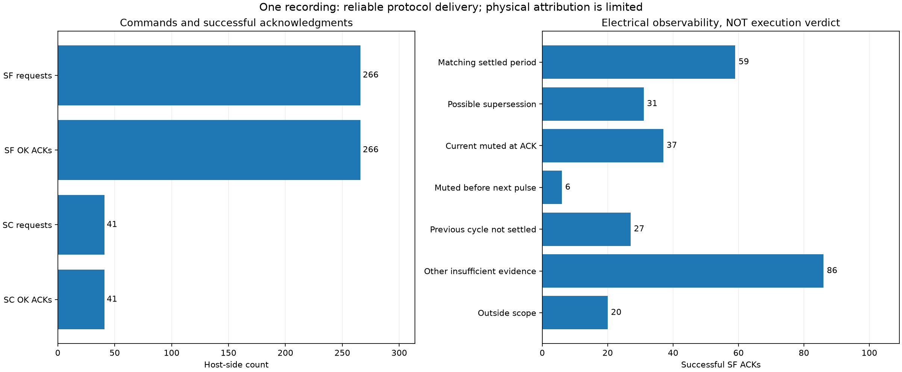

*Figure — Host SF/SC requests and successful acknowledgments on the left; SF acknowledgments grouped by available settled electrical-period evidence on the right. The panels have different denominators.*

Machine-readable scorecard (local supporting evidence: \`results/20261124T114542660847Z_integrated_hw_10M_20s_resume_check/analysis/command_delivery_scorecard.json\`) · Per-SF ACK classification (local supporting evidence: \`results/20261124T114542660847Z_integrated_hw_10M_20s_resume_check/analysis/ack_physical_observability/sf_ack_observability.csv\`) · Per-command host timing (local supporting evidence: \`results/20261124T114542660847Z_integrated_hw_10M_20s_resume_check/analysis/command_timing/sf_command_latency.csv\`).

## Main measurements

| Measurement | Result |
| --- | ---: |
| Operator-approved biphasic CH1 onsets | 418 |
| Consecutive approved CH1 intervals | 417 |
| Negative-only events explicitly excluded by operator | 11 |
| Regular prior-ACK mismatches including muted/SC context | 73 |
| Active transitions with compatible in-interval ACK | 67 |
| All mismatches with in-interval match including SC context | 68 |
| Excluded negative-only events following latest SC0 (nominal map) | 11 |
| Successful SF request/ACK pairs in full session | 266 |
| Successful SC request/ACK pairs in full session | 41 |
| SF ACKs with matching *settled* physical interval in prior audit | 59 |

## 1. Approved steady-state frequency and per-ACK observability

Steady-state frequency compatibility and per-ACK observability describe **different subsets** and must not be combined into an execution rate.
The previous robustness audit evaluated **85** baseline eligible ACK intervals (see its full tolerance criteria).

The previous per-ACK audit classified **246** successful SF ACKs inside the estimated scope window. A matching physical interval is compatibility evidence, not unique causation.

Detailed per-ACK report (local supporting evidence: \`results/20261124T114542660847Z_integrated_hw_10M_20s_resume_check/analysis/ack_physical_observability/final_report.md\`) · Steady-state robustness (local supporting evidence: \`results/20261124T114542660847Z_integrated_hw_10M_20s_resume_check/analysis/frequency_robustness_report.md\`).

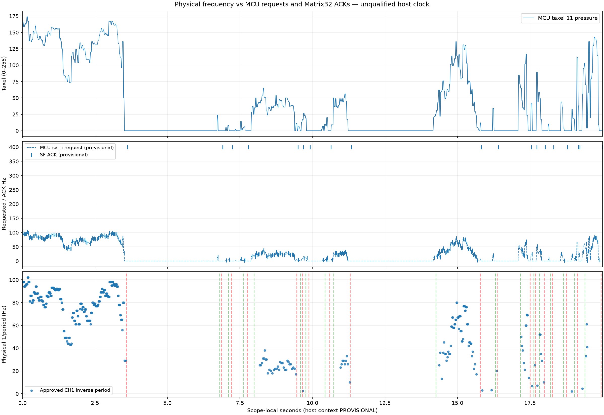

*Figure — Approved physical pulse periods and provisionally aligned SF control events. Positions across the host and scope clocks are not independently calibrated.*

## 2. Rapid frequency transitions

**73** regular intervals are not compatible with the last preceding ACK under the nominal map. **67** are active intervals with a compatible in-interval SF ACK and no SC transition. The remaining prior-ACK mismatches involve muted/SC-transition context. Neither count demonstrates device failure or proves cycle-boundary application.

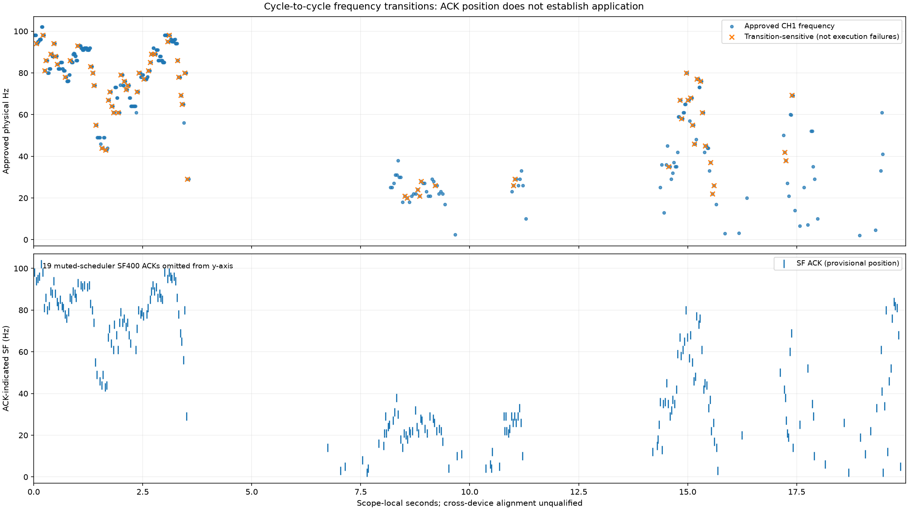

*Figure — Approved scope-local pulse frequencies alongside provisionally placed SF acknowledgments. Cross-clock event ordering is conditional on the adopted mapping.*

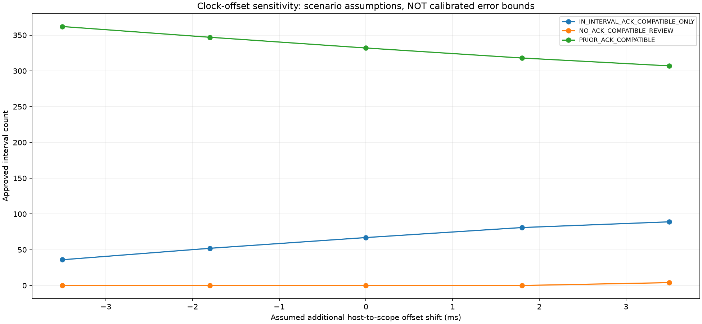

*Figure — Transition classifications under alternative assumed host-to-scope offsets. Scenarios are not calibrated confidence limits.*

Full transition report (local supporting evidence: \`results/20261124T114542660847Z_integrated_hw_10M_20s_resume_check/analysis/frequency_transitions/report.md\`) · Per-interval transition evidence (local supporting evidence: \`results/20261124T114542660847Z_integrated_hw_10M_20s_resume_check/analysis/frequency_transitions/transitions.csv\`).

## 3. Current shutdown and restart

The signed review excluded **11** negative-only events. The time association with SC0 remains provisional; a negative voltage excursion does not demonstrate current delivery, and SC0 ACK does not identify the electrical shutdown instant.

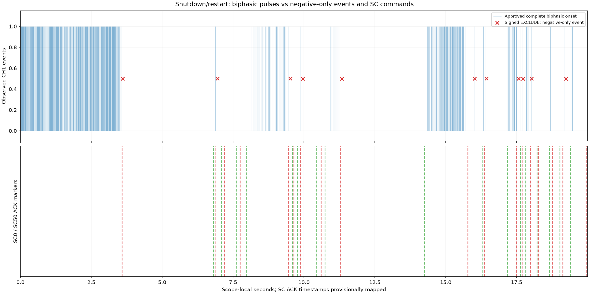

*Figure — Complete approved pulses, excluded negative-only events, and provisionally positioned SC0/SC50 acknowledgments.*

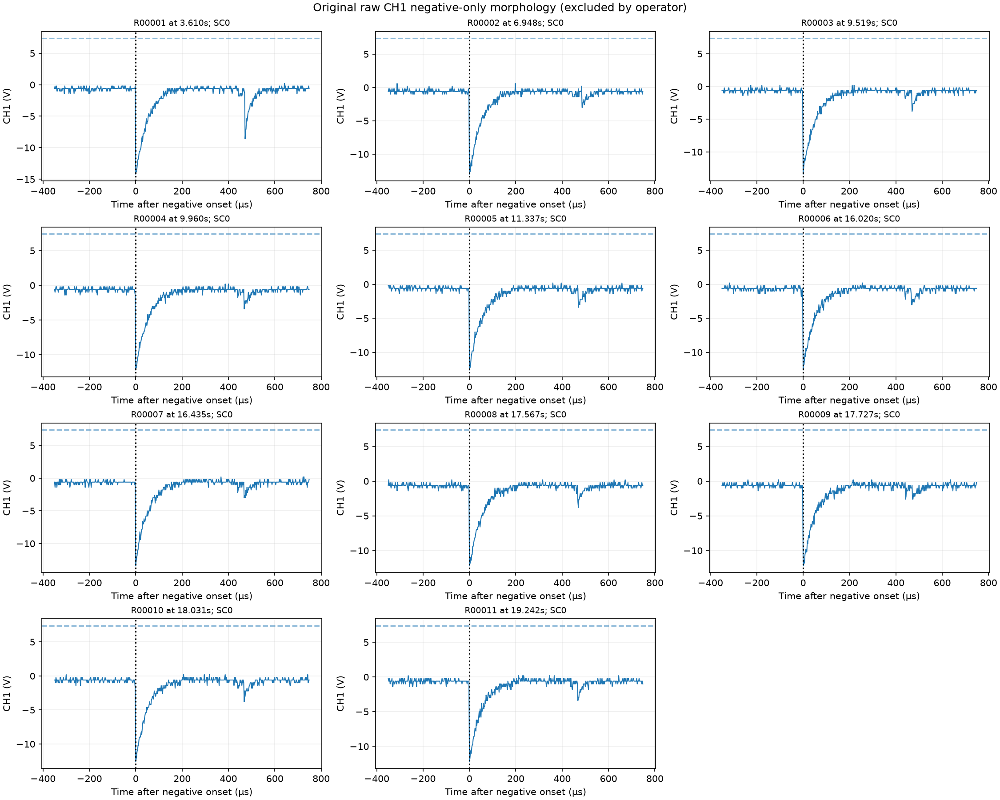

*Figure — Voltage characteristics of operator-excluded negative-only events. These are not counted as complete biphasic pulses.*

Full shutdown report (local supporting evidence: \`results/20261124T114542660847Z_integrated_hw_10M_20s_resume_check/analysis/stimulation_shutdown/report.md\`) · Incomplete event evidence (local supporting evidence: \`results/20261124T114542660847Z_integrated_hw_10M_20s_resume_check/analysis/stimulation_shutdown/incomplete_events.csv\`).

## 4. Host command timing and cycle opportunities

Host-observed SF request-to-ACK latency median: **16.324 ms**. This is protocol completion time, NOT physical application latency.

MCU message arrival median: **14.501 ms**, SD **0.128 ms**. SF request median spacing: **42.238 ms**. These describe the full logged session; long SF gaps can be deliberate idle/muted intervals, not radio jitter.

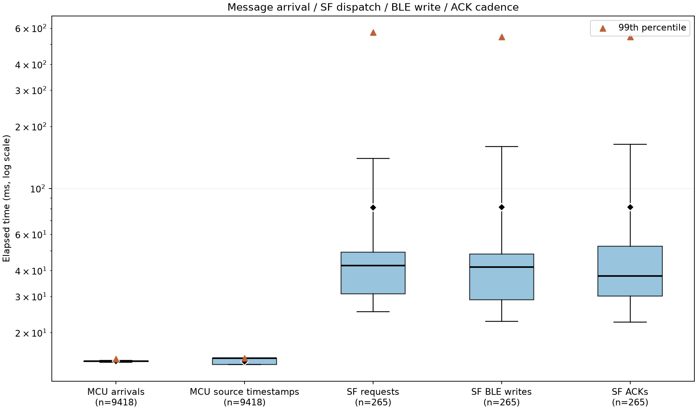

*Figure — MCU message and SF command spacing: boxes show P25–P75, lines medians, diamonds means, whiskers P05–P95, triangles P99. Times use a logarithmic axis.*

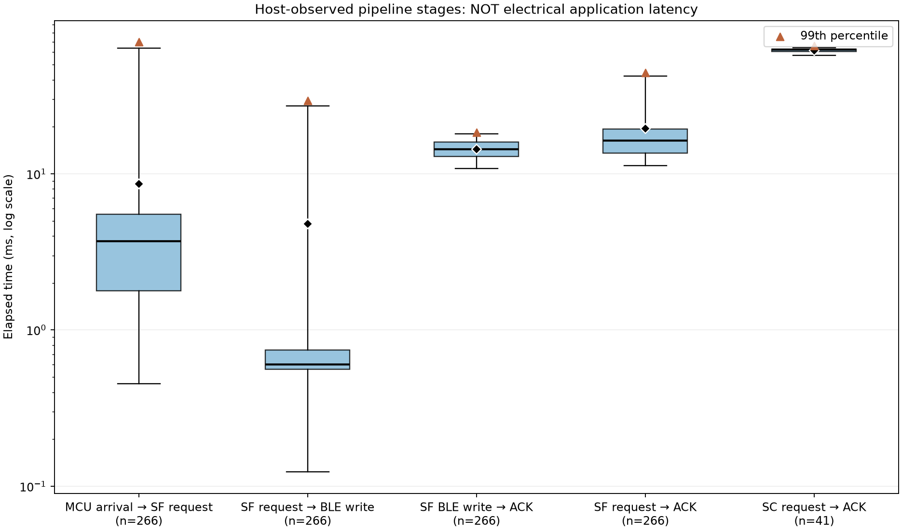

*Figure — Host-observed MCU-to-request, request-to-write, and write-to-ACK durations. Percentile and mean markers follow the other timing box plot.*

Full timing statistics and tails (local supporting evidence: \`results/20261124T114542660847Z_integrated_hw_10M_20s_resume_check/analysis/command_timing/timing_distribution_statistics.csv\`) · Original timing samples (local supporting evidence: \`results/20261124T114542660847Z_integrated_hw_10M_20s_resume_check/analysis/command_timing/timing_distribution_samples.csv\`).

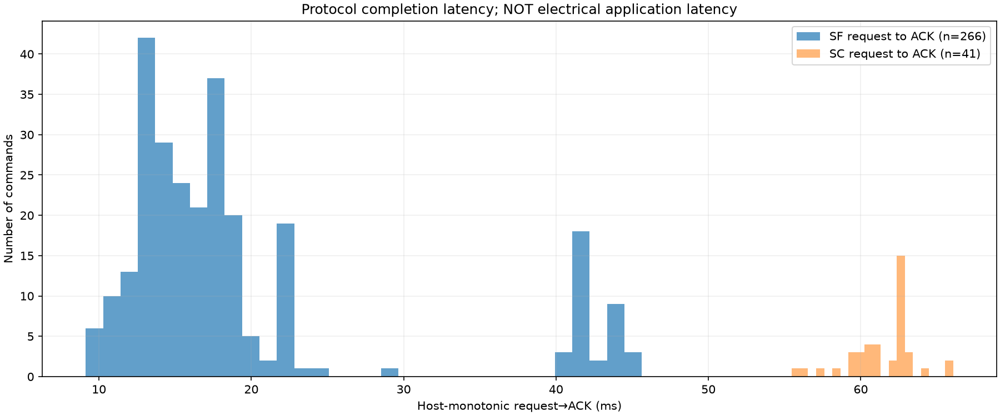

*Figure — SF and SC host-monotonic request-to-ACK durations, not measured electrical application latency.*

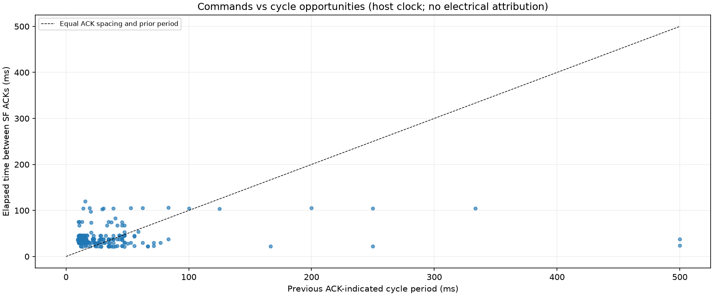

*Figure — Spacing between SF acknowledgments compared with the previous acknowledged cycle period; the diagonal indicates equal durations.*

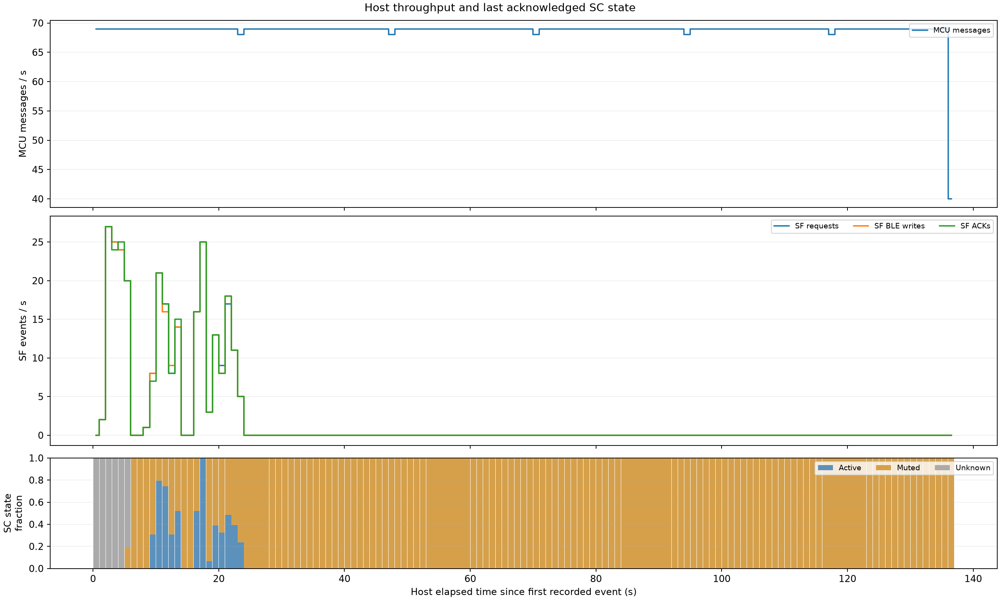

*Figure — One-second counts of MCU arrivals, SF requests, BLE writes and SF ACKs. Bottom bars give each second’s fraction in the last acknowledged SC state, including unknown time.*

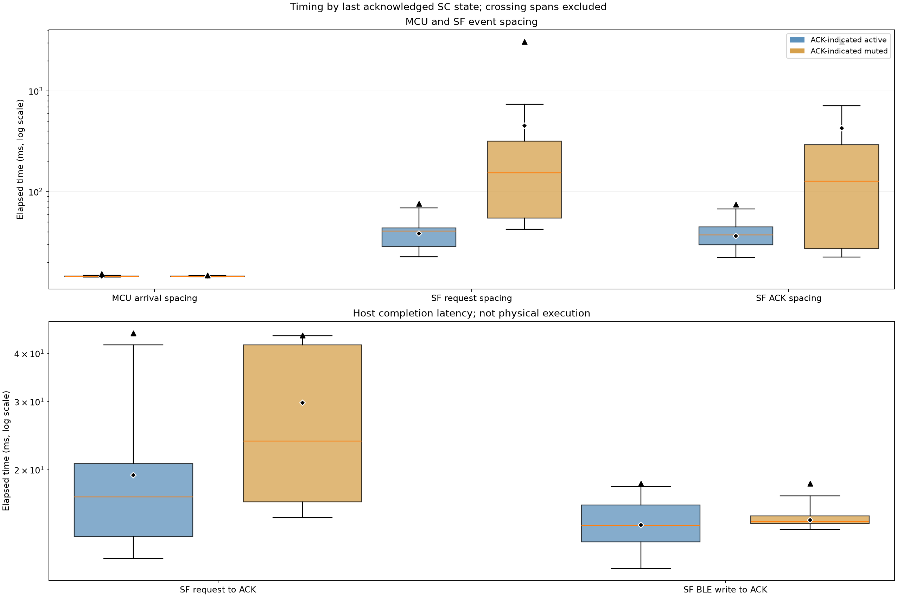

*Figure — Timing grouped by last acknowledged SC state; durations spanning an SC ACK or preceding the first SC ACK are excluded. Boxes/markers use the timing box-plot convention.*

Per-second counts (local supporting evidence: \`results/20261124T114542660847Z_integrated_hw_10M_20s_resume_check/analysis/command_timing/throughput_per_second.csv\`) · Per-state timing statistics (local supporting evidence: \`results/20261124T114542660847Z_integrated_hw_10M_20s_resume_check/analysis/command_timing/state_timing_statistics.csv\`).

Full host timing report (local supporting evidence: \`results/20261124T114542660847Z_integrated_hw_10M_20s_resume_check/analysis/command_timing/report.md\`) · Per-SF protocol timing (local supporting evidence: \`results/20261124T114542660847Z_integrated_hw_10M_20s_resume_check/analysis/command_timing/sf_command_latency.csv\`).

## Confidence and remaining limitations

1. **Measured directly:** scope-local intervals between approved biphasic pulses; original negative-only CH1 waveforms; host-monotonic request/ACK durations.
2. **Conditional on unqualified cross-clock mapping:** assigning SF/SC ACKs to individual electrical cycles; apparent latency from SC0 to negative-only events.
3. **Hypotheses, not proven:** cycle-boundary frequency updates, internally superseded SFs, and the mechanism responsible for incomplete voltage dips.
4. **Not established:** electrical current or charge balance, exact turn-off time, physical command-application latency, or per-command execution percentage.

This is a resistive dummy-load bench experiment, not a safety validation.

## Reproducibility

All analyses read immutable signed evidence and write only under the `analysis/` tree. Each module records source SHA-256 fingerprints, software version and assumptions in its `summary.json`.

Full machine-readable provenance (local supporting evidence: \`results/20261124T114542660847Z_integrated_hw_10M_20s_resume_check/analysis/extended_analysis_manifest.json\`).
