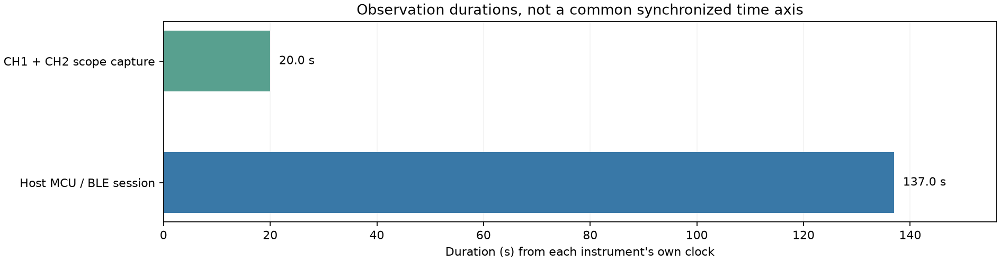
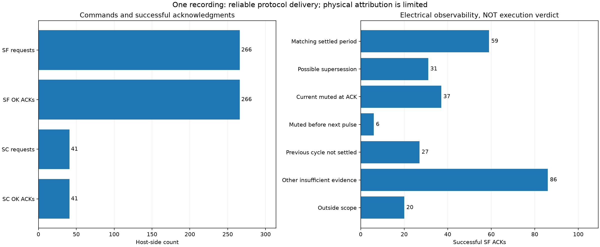
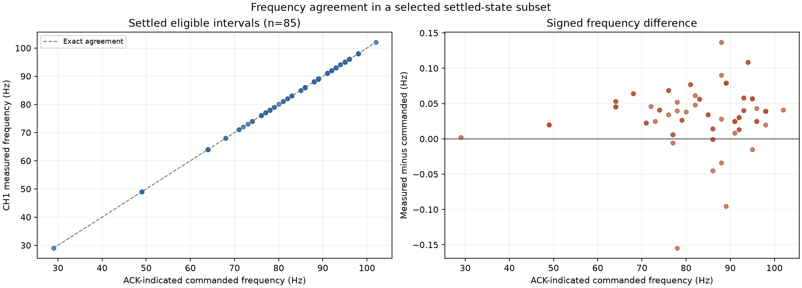
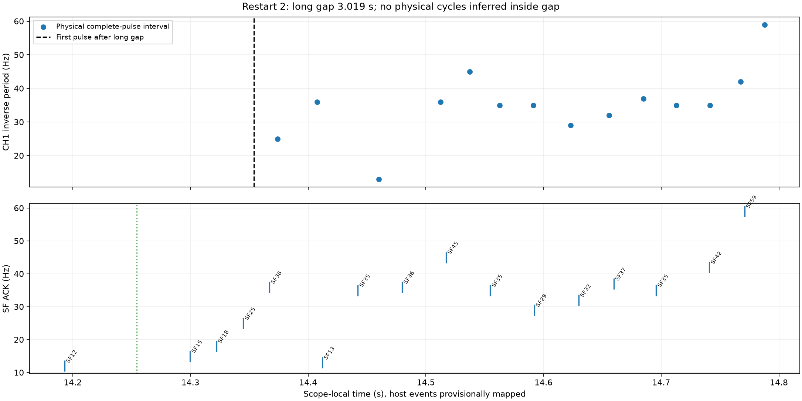
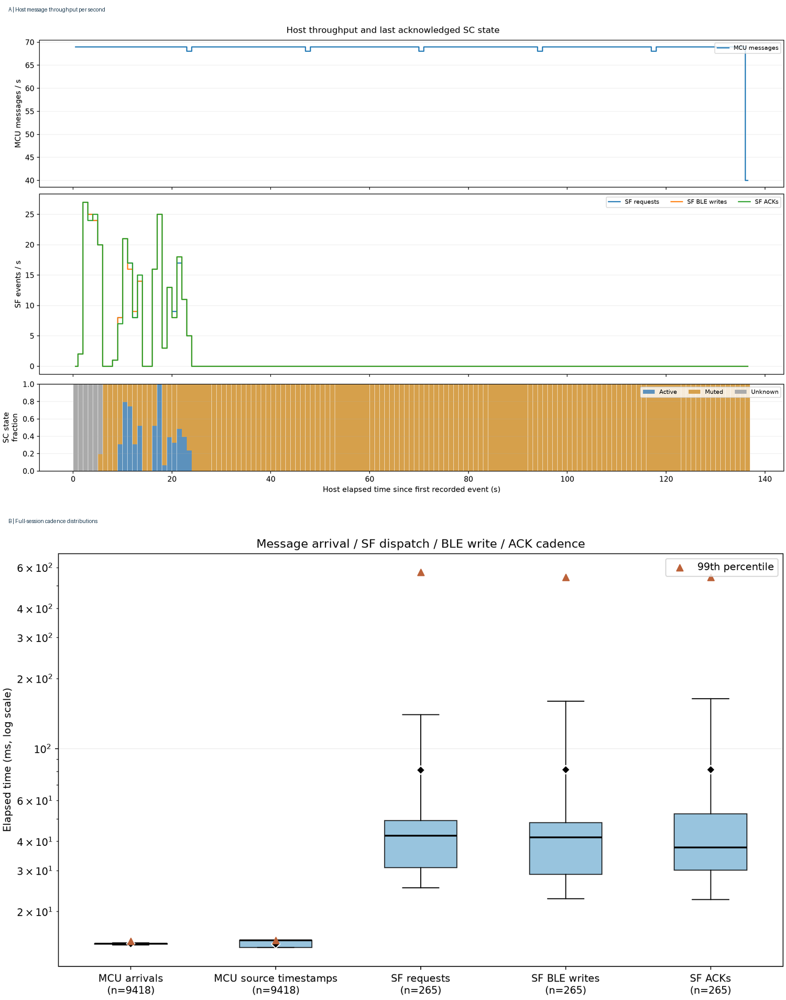
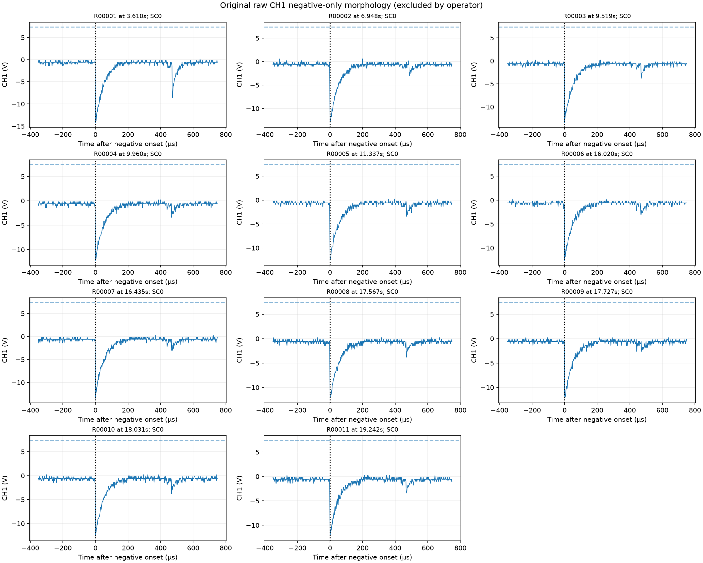

<!-- Source: results/20261124T114542660847Z_integrated_hw_10M_20s_resume_check/analysis/final_experiment_report.md. Published snapshot; scientific numbers unmodified. -->

# Matrix32 tactile-to-electrical stimulation: consolidated experiment report

**Recording:** 20261124T114542660847Z_integrated_hw_10M_20s_resume_check

> **Principal conclusion.** All recorded SF frequency requests received successful protocol acknowledgments. Within a selected stable-state subset, electrical pulse periods agree closely with the acknowledged frequencies. Rapid updates, muted states and unqualified cross-clock alignment prevent a defensible per-command electrical execution or failure rate.

## At a glance: research questions and evidence

| Question | Result | Evidence classification |
| --- | --- | --- |
| Were frequency requests acknowledged? | **266/266 SF OK ACKs**; 0 missing | Direct host protocol record |
| Were current-control requests acknowledged? | **41/41 SC OK ACKs** | Direct host protocol record |
| Were stable frequencies reproduced? | **85/85 eligible** intervals within diagnostic tolerance; median absolute difference 0.039 Hz | Direct CH1 periods + conditional command pairing |
| Can every acknowledged change be proven electrically executed? | **No**: 59 in-scope ACKs have matching settled-period evidence; exact executed/failed counts unidentifiable | Conditional compatibility, not command execution proof |
| What happens with rapid commands? | 67 active transitions compatible with an in-interval SF ACK at nominal alignment | Timing-sensitive association |
| What are the incomplete events? | 11 signed negative-only exclusions, not complete pulses | Direct voltage morphology; command relationship provisional |
| How regular is tactile ingress? | 14.502 +/- 0.128 ms (mean +/- SD) | Direct PC arrival intervals |

## Experiment and measurement windows

A single Tektronix record captured **CH1 electrical output across an operator-verified isolated resistive dummy load** and **CH2 Nano Every D7 timecode** at approximately **10,000,000 samples per channel** for an approximately **20-second** scope window. The MCU/controller logs span approximately **137 seconds** and contain **9,419 MCU message arrivals**. The 20-second waveform and much longer host session are different observation windows; the host-to-scope offset is **not independently qualified**. No person was connected. The controller selected tactile taxel **11** with **sa_ii** encoding.

*Figure 1 - Bars show total available host-log and scope-record durations using their respective clocks. The lengths do not indicate alignment or overlap of individual events.*

**Evidence handling.** Physical periods use consecutive onset timestamps of **418** operator-approved, positive-phase-confirmed biphasic CH1 pulses (**417** intervals). The **11** operator-excluded negative-only events remain separate diagnostics. No approved pulse, review decision, original waveform or Nano clock fit is changed by report generation.

**Operator cue schedule (host timer only):** 0 s (hold the selected taxel steady. follow the next release cue), 3 s (release the selected taxel completely), 6 s (press gently, then hold steady), 10 s (release the selected taxel completely), 13 s (press more firmly, then hold until the scope acquisition ends). Cue delivery is not proof of an operator action or of an event at that time on CH1.

## 1. Frequency requests and protocol delivery

The controller issued **266 SF value-change requests**, all acknowledged OK; **22** were SF400 muted-scheduler commands and cannot be interpreted as 400 Hz electrical stimulation. All **41** SC commands were acknowledged OK. Of the SF ACKs, **246** lie within the *estimated* waveform window; **59** have at least one matching isolated settled physical interval under the audit assumptions, and **187** do not. The remaining **20** ACKs are outside the estimated waveform window. These categories **must not** be converted to an executed/not-executed fraction.

*Figure 2 - Left: SF and SC host request/ACK totals. Right: mutually exclusive SF ACK observability categories based on the provisional scope mapping; a matching period is not unique proof of electrical application.*

## 2. Settled-state electrical frequency agreement

Across **85** eligible settled CH1 intervals, **85** fall within diagnostic tolerance; the median absolute error is **0.039 Hz**, the 95th percentile is **0.094 Hz** and the maximum is **0.155 Hz**. A stricter timing qualification leaves **5** comparable intervals (**5** within tolerance). This is evidence of frequency accuracy for selected observable states, **not** for every request or every physical cycle.

*Figure 3 - Left: measured inverse-period frequency versus ACK-indicated command for eligible settled intervals (dashed line = equality). Right: signed measured-minus-commanded frequency difference; zero denotes agreement. Excluded and transition-sensitive intervals are not plotted.*

Detailed robustness report (local supporting evidence: \`results/20261124T114542660847Z_integrated_hw_10M_20s_resume_check/analysis/frequency_robustness_report.md\`) | Eligible-interval evidence (local supporting evidence: \`results/20261124T114542660847Z_integrated_hw_10M_20s_resume_check/analysis/frequency_robustness_all_intervals.csv\`)

## 3. Rapid frequency updates and transition observability

In the nominal provisional map, **73** regular intervals do not match the preceding SF ACK; **67** active intervals are compatible with an SF ACK inside the same physical cycle. The selected transition example displays the relationship between ACKs and observed physical periods, without establishing firmware scheduling causation. Cross-clock event order depends on the assumed mapping.

*Figure 4 - Top: physical CH1 inverse-period frequencies between approved biphasic pulses near a restart. Bottom: SF ACK frequencies provisionally mapped to the scope clock. The dashed line marks the first pulse following a long pause; no continuous stimulation is inferred inside that gap.*

**Timing sensitivity (not a confidence interval).** Moving the assumed host-to-scope offset changes which SF ACKs appear inside each electrical interval:

| Hypothetical host-to-scope shift (ms) | Active intervals compatible only with an in-interval SF ACK |
| ---: | ---: |
| -3.5 | 36 |
| -1.8 | 52 |
| +0.0 | 67 |
| +1.8 | 81 |
| +3.5 | 89 |

These are hypothetical alignment scenarios **not calibrated uncertainty bounds**. A precise electrical application instant for each ACK has not been measured.

Per-cycle transition evidence (local supporting evidence: \`results/20261124T114542660847Z_integrated_hw_10M_20s_resume_check/analysis/frequency_transitions/transitions.csv\`) | All transition figures and offset scenarios (local supporting evidence: \`results/20261124T114542660847Z_integrated_hw_10M_20s_resume_check/analysis/frequency_transitions/report.md\`)

## 4. Host scheduling and BLE communication

The MCU-to-host stream contains **9,419** messages at **14.501 ms median** inter-arrival spacing, with SD **0.128 ms**. SF requests have a **42.238 ms** median spacing, and SF request-to-ACK completion has **16.324 ms** median latency. The 95th percentile of SF request-to-BLE-write delay is **27.251 ms**, compared with **18.091 ms** for BLE-write-to-ACK. Inter-request gaps reflect controller decisions and muted intervals, **not radio jitter**. All request/ACK timing is measured on the same PC clock and does not quantify electrical application latency.

*Figure 5 - Panel A: per-second MCU arrivals, SF host requests, BLE writes and ACKs with ACK-indicated current state. Panel B: box-and-whisker distributions of the corresponding full-session message cadences. Long command-free gaps are included; source state and host timing are not electrical output measurements.*

Detailed timing distributions (local supporting evidence: \`results/20261124T114542660847Z_integrated_hw_10M_20s_resume_check/analysis/command_timing/report.md\`) | State-separated timing (local supporting evidence: \`results/20261124T114542660847Z_integrated_hw_10M_20s_resume_check/analysis/command_timing/state_timing_statistics.csv\`) | Per-second throughput (local supporting evidence: \`results/20261124T114542660847Z_integrated_hw_10M_20s_resume_check/analysis/command_timing/throughput_per_second.csv\`)

## 5. Current shutdown, restart and incomplete waveforms

The signed inventory excludes **11** negative-only voltage events. Under the nominal mapping, **11** occur after the latest SC0 ACK. Their morphology is directly observed, but SC0 timing is only provisionally associated and does not establish an electrical cutoff time or voltage-transient mechanism.

*Figure 6 - Operator-excluded negative-only CH1 voltage events. Each lacks the required positive-phase confirmation and contributes neither an approved biphasic pulse nor a measured stimulation period.*

Current-transition analysis (local supporting evidence: \`results/20261124T114542660847Z_integrated_hw_10M_20s_resume_check/analysis/stimulation_shutdown/report.md\`) | Source event details (local supporting evidence: \`results/20261124T114542660847Z_integrated_hw_10M_20s_resume_check/analysis/stimulation_shutdown/incomplete_events.csv\`)

## Conclusions and remaining questions

**Established:** All recorded SF and SC requests have successful protocol replies; selected settled biphasic electrical cycles have small frequency deviations; the MCU stream arrives at a regular host cadence. **Suggestive, not established:** Rapid SF updates may be superseded or deferred; incomplete CH1 excursions coincide with SC0-indicated states. **Not determined:** Which individual acknowledged SF values were electrically applied, precise command-to-output latency, electrical current or charge balance, and the internal frequency-update scheduling rule. This experiment is **not a safety validation**.

**Best follow-up experiment:** Use intentionally spaced single-frequency plateaus and short bursts across a verified dummy load, with an independently calibrated timing marker relating command transmission to CH1. That can test deferred/superseded update hypotheses without relying on nominal host-to-scope alignment.

## Detailed evidence, limitations and reproducibility

| Supporting analysis | Evidence |
| --- | --- |
| Per-ACK audit (local supporting evidence: \`results/20261124T114542660847Z_integrated_hw_10M_20s_resume_check/analysis/ack_physical_observability/final_report.md\`) | Individual ACK classifications and clock-association caveats |
| Robustness audit (local supporting evidence: \`results/20261124T114542660847Z_integrated_hw_10M_20s_resume_check/analysis/frequency_robustness_report.md\`) | Full tolerance definitions, period/frequency errors, held-out clock tests |
| Frequency transitions (local supporting evidence: \`results/20261124T114542660847Z_integrated_hw_10M_20s_resume_check/analysis/frequency_transitions/report.md\`) | Full interval classifications and offset sensitivity |
| Shutdown and restart (local supporting evidence: \`results/20261124T114542660847Z_integrated_hw_10M_20s_resume_check/analysis/stimulation_shutdown/report.md\`) | All signed negative-only source events |
| Command timing (local supporting evidence: \`results/20261124T114542660847Z_integrated_hw_10M_20s_resume_check/analysis/command_timing/report.md\`) | Cadence distributions, active/muted comparisons and BLE timing |
| Legacy consolidated report (local supporting evidence: \`results/20261124T114542660847Z_integrated_hw_10M_20s_resume_check/analysis/extended_analysis_technical_report.md\`) | Previous 12-figure technical index, retained in full |

The experiment used one 20-second scope record and a longer continuous host/controller log; a Nano Gray-timecode mapping was analyzed but **not qualified**. All exported evidence remains linked to the signed review and SHA-256 source fingerprints. Original waveforms, current-control commands, approval signatures, and clock evidence were not rewritten.

Analysis provenance (local supporting evidence: \`results/20261124T114542660847Z_integrated_hw_10M_20s_resume_check/analysis/extended_analysis_manifest.json\`) | Protocol and physical observability scorecard (local supporting evidence: \`results/20261124T114542660847Z_integrated_hw_10M_20s_resume_check/analysis/command_delivery_scorecard.json\`)
