<!-- Source: results/20261124T114542660847Z_integrated_hw_10M_20s_resume_check/analysis/report_revision/extended_analysis_technical_report.md. Published snapshot; scientific numbers unmodified. -->

# Matrix32 — consolidated experimental analysis

**Approved revision.** Signed reference and four separate recordings replaying the same source input. Historical approved analyses are preserved; revised calculations do not redetect pulses or recalibrate clocks.

## Requested → ACKed → physically observed (executive scorecard)

Across the shared replay recordings, **317–319 of 461** target SF ACKs (68.76%–69.20%) are represented in the assessed physical output under the cycle-boundary/latest-pending-SF model and chronological attribution. The corresponding baseline estimate is **313/434** (72.12%). Ordinary shared SF updates have 317/416 local matching coverage (76.20%), versus 307/398 (77.14%) for baseline. Across the four replays, 1480/1480 assessed periods match a candidate; 105 of 1585 approved intervals are not assessed. These are model-conditioned observability estimates, not independently measured device execution or failure rates.

| Label | Recording ID | Approved pulses | Intervals | Excluded negative-only | SF OK/requested | SC OK/requested |
| --- | --- | --- | --- | --- | --- | --- |
| Reference | 20261124T114542660847Z_integrated_hw_10M_20s_resume_check | 418 | 417 | 11 | 266/266 | 41/41 |
| A1 | 20261126T090848918698Z_ble_ab_baseline | 400 | 399 | 11 | 247/247 | 37/37 |
| B1 | 20261126T091212099927Z_ble_ab_shared | 395 | 394 | 12 | 263/263 | 45/45 |
| A2 | 20261126T094712943788Z_ble_ab_baseline_20vdiv | 393 | 392 | 12 | 245/245 | 37/37 |
| B2 | 20261126T095023427339Z_ble_ab_shared_20vdiv | 401 | 400 | 12 | 263/263 | 45/45 |

| Run | SF OK ACKs | Muted inside | Outside/edge | Target ACKs inside support | Unique local | Distinct chronological | Chronological coverage | Matching/assessed cycles |
| --- | --- | --- | --- | --- | --- | --- | --- | --- |
| Reference | 266 | 18 | 24 | 224 | 123 | 162–164 | 72.32%–73.21% | 386/386 |
| A1 | 247 | 19 | 10 | 218 | 118 | 155 | 71.10% | 367/367 |
| B1 | 263 | 24 | 10 | 229 | 107 | 157 | 68.56% | 368/368 |
| A2 | 245 | 19 | 10 | 216 | 129 | 158 | 73.15% | 368/368 |
| B2 | 263 | 23 | 8 | 232 | 117 | 160–162 | 68.97%–69.83% | 377/377 |
| Replay baseline pooled | 492 | 38 | 20 | 434 | 247 | 313 | 72.12% | 735/735 |
| Replay shared pooled | 526 | 47 | 18 | 461 | 224 | 317–319 | 68.76%–69.20% | 745/745 |

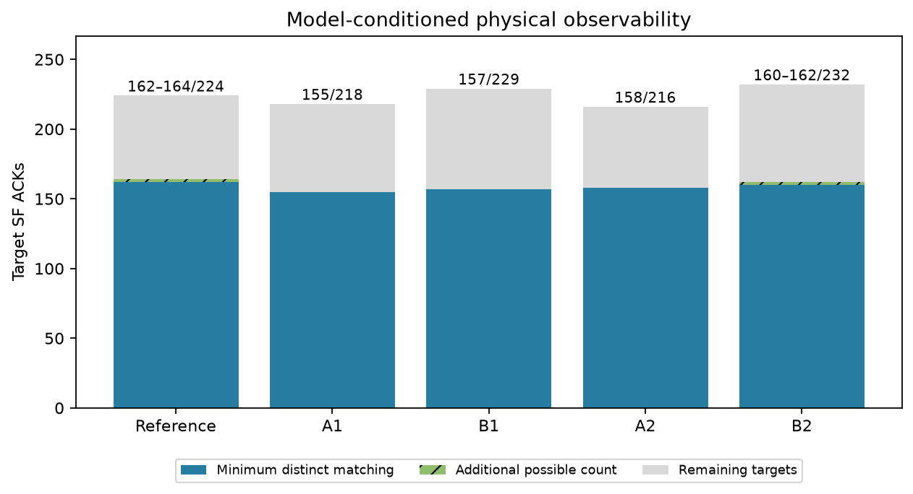

*Chronological distinct ACK count bounds for the reference and each replay. Target counts exclude muted-scheduler SF commands and outside-support ACKs.*

| Replay transport | SF purpose | Target ACKs | Local matches | Local coverage | Required on all paths | Optional on paths |
| --- | --- | --- | --- | --- | --- | --- |
| baseline | ordinary | 398 | 307 | 77.14% | 307 | 0 |
| baseline | restore | 36 | 6 | 16.67% | 6 | 0 |
| shared | ordinary | 416 | 317 | 76.20% | 315 | 2 |
| shared | restore | 45 | 2 | 4.44% | 2 | 0 |

## 1. Approved steady-state frequency and per-ACK observability

A frequency selection is modeled at an approved negative pulse onset for the following cycle. Latest available SF wins; a subsequent SF within that cycle does not invalidate the period. Availability is assumed between host BLE write begin and embedded ACK receipt; the ACK does not establish the internal application instant. Candidate identities are enumerated independently of frequency error and constrained to nondecreasing chronological order. Each distinct live target ACK is counted once; repeated numeric values remain different command identities. The target denominator is successful SF ACKs with trace ACK inside Gray support, excluding muted-scheduler SF400 but including restore SF attempts. Initial START frequency is context, not a live SF ACK. SC transitions, unsupported boundaries and long pauses (>0.5 s) are excluded from primary cycle attribution. Matching tolerance is max(1 Hz, 2.5%); tighter tolerances and 1×/2×/3× timing margins are sensitivity tests. A path through individual boundary envelopes is not proof that one jointly feasible clock realization or one exact firmware history produced every period.

The earlier approved reference analysis reported 59 in-scope ACKs with isolated settled evidence and 85 eligible intervals (85 within tolerance). These are historical affine-map/settled-window quantities, not the revised denominator or execution count. The revised settled reference uses integer controller targets rather than raw float MCU rates.

| Run | Stable reference | Eligible/all intervals | Median \|error\| Hz | P95 Hz | Max Hz |
| --- | --- | --- | --- | --- | --- |
| Reference | Integer controller target | 190/417 | 0.057 | 11.545 | 55.061 |
| Reference | ACK-indicated SF | 81/417 | 0.039 | 0.090 | 0.137 |
| A1 | Integer controller target | 176/399 | 0.055 | 8.255 | 51.051 |
| A1 | ACK-indicated SF | 77/399 | 0.038 | 0.079 | 0.207 |
| B1 | Integer controller target | 177/394 | 0.055 | 9.427 | 55.061 |
| B1 | ACK-indicated SF | 86/394 | 0.039 | 0.091 | 0.407 |
| A2 | Integer controller target | 174/392 | 0.048 | 10.984 | 39.007 |
| A2 | ACK-indicated SF | 74/392 | 0.039 | 0.077 | 0.269 |
| B2 | Integer controller target | 177/400 | 0.056 | 14.978 | 55.061 |
| B2 | ACK-indicated SF | 83/400 | 0.039 | 0.141 | 0.391 |

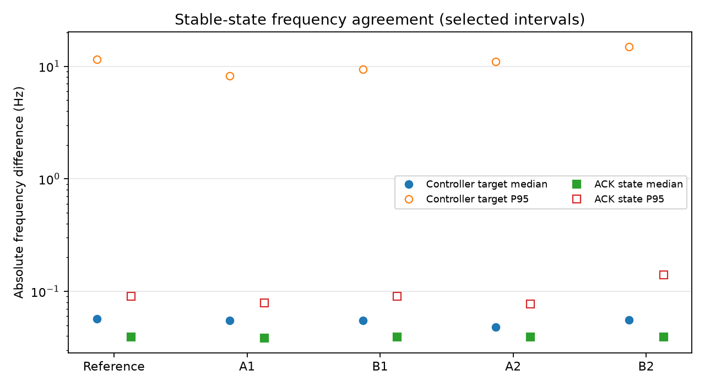

*Median and P95 absolute error for stable integer target and ACK states across the signed records. Error comparisons use different eligible subsets.*

For the identical subset where both integer target and ACK states are stable:

| Run | Reference on identical eligible intervals | N | Median \|error\| Hz | P95 Hz | Max Hz |
| --- | --- | --- | --- | --- | --- |
| Reference | controller_target | 36 | 0.516 | 6.348 | 17.039 |
| Reference | ack | 36 | 0.039 | 0.095 | 0.137 |
| A1 | controller_target | 23 | 0.045 | 7.714 | 9.030 |
| A1 | ack | 23 | 0.039 | 0.058 | 0.058 |
| B1 | controller_target | 30 | 0.052 | 5.546 | 9.030 |
| B1 | ack | 30 | 0.039 | 0.072 | 0.090 |
| A2 | controller_target | 26 | 0.040 | 2.969 | 5.025 |
| A2 | ack | 26 | 0.039 | 0.057 | 0.076 |
| B2 | controller_target | 28 | 0.049 | 5.939 | 15.069 |
| B2 | ack | 28 | 0.039 | 0.148 | 0.249 |

Historical original reference per-ACK overview (unchanged figure; provisional affine placement, retained for audit history):

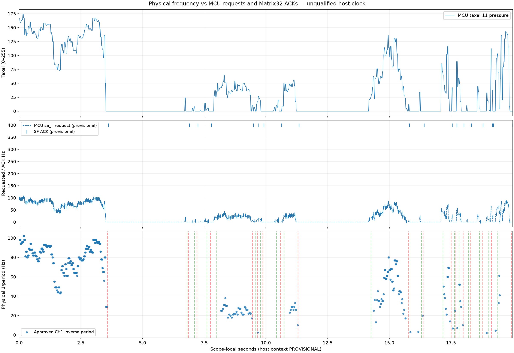

## 2. Rapid frequency transitions and clock-model sensitivity

CH1 and CH2 share the scope clock. Hardware-timed Nano Gray START edges are logged by an ISR; its timestamp latency is not calibrated. Scope-to-Nano piecewise interpolation is evaluated by blocked held-out anchors, not selected by frequency agreement. Nano-to-PC four-timestamp USB exchanges constrain an affine slope/offset envelope without assuming symmetric USB transport. Widening by held-out Gray P95 is heuristic. No extrapolation outside Gray anchors is allowed. Local rate deviation still exceeds the 250 ppm qualification criterion; absolute cross-clock error and physical application latency remain uncalibrated. Physical periods themselves use only the scope clock.

| Run | Gray frames | Affine 1-frame RMS µs | Piecewise 1-frame RMS µs | 1 s RMS µs | 2 s RMS µs | Local rate deviation ppm | Max tested host envelope ms |
| --- | --- | --- | --- | --- | --- | --- | --- |
| Reference | 199 | 172.64 | 4.74 | 18.42 | 51.10 | 400.2 | 6.325 |
| A1 | 199 | 178.93 | 5.02 | 16.57 | 45.33 | 359.6 | 6.330 |
| B1 | 199 | 196.93 | 4.90 | 23.72 | 50.70 | 350.1 | 6.372 |
| A2 | 199 | 143.51 | 4.77 | 21.05 | 29.15 | 379.8 | 6.276 |
| B2 | 199 | 120.61 | 4.34 | 24.26 | 42.13 | 439.7 | 6.309 |

### Conservative settled-window comparison

Request, actual validated BLE write and embedded ACK endpoints are tested. The next-write boundary is physically better motivated than request; the next-ACK endpoint may include an already-available newer command. The previous-cycle guard is a settling assumption, not a measured bound. Missing BLE timing falls back to request.

| Run | Next control boundary | Target ACKs | Matching with guard | Matching without guard |
| --- | --- | --- | --- | --- |
| Reference | request | 224 | 11 | 49 |
| Reference | write | 224 | 11 | 51 |
| Reference | ack | 224 | 53 | 106 |
| A1 | request | 218 | 11 | 52 |
| A1 | write | 218 | 11 | 55 |
| A1 | ack | 218 | 53 | 98 |
| B1 | request | 229 | 16 | 52 |
| B1 | write | 229 | 16 | 52 |
| B1 | ack | 229 | 54 | 88 |
| A2 | request | 216 | 13 | 46 |
| A2 | write | 216 | 13 | 49 |
| A2 | ack | 216 | 48 | 103 |
| B2 | request | 232 | 13 | 50 |
| B2 | write | 232 | 14 | 50 |
| B2 | ack | 232 | 50 | 97 |

### Cycle-boundary attribution and chronology

Tolerance scenarios are original max(1 Hz, 2.5%), tight max(0.5 Hz, 1%), very tight max(0.25 Hz, 0.5%). A path through matching periods only is explicitly conditional if an assessed period is incompatible.

| Gray margin | Tolerance | Baseline distinct | Shared distinct | Matching/assessed cycles | Path status |
| --- | --- | --- | --- | --- | --- |
| 1.0 | original | 313 | 317–319 | 1480/1480 | COMPLETE_ASSESSED_PATH |
| 1.0 | tight | 313 | 319 | 1480/1480 | COMPLETE_ASSESSED_PATH |
| 1.0 | very_tight | 313 | 319 | 1479/1480 | COMPLETE_ASSESSED_PATH; MATCHING_SUBSET_ONLY |
| 2.0 | original | 313 | 317–319 | 1480/1480 | COMPLETE_ASSESSED_PATH |
| 2.0 | tight | 313 | 319 | 1480/1480 | COMPLETE_ASSESSED_PATH |
| 2.0 | very_tight | 313 | 319 | 1479/1480 | COMPLETE_ASSESSED_PATH; MATCHING_SUBSET_ONLY |
| 3.0 | original | 313 | 317–319 | 1480/1480 | COMPLETE_ASSESSED_PATH |
| 3.0 | tight | 313 | 319 | 1480/1480 | COMPLETE_ASSESSED_PATH |
| 3.0 | very_tight | 313 | 319 | 1479/1480 | COMPLETE_ASSESSED_PATH; MATCHING_SUBSET_ONLY |

Unmatched local target-command evidence (1× original):

| Classification | Baseline | Shared |
| --- | --- | --- |
| ACTIVE_BOUNDARY_WITHOUT_ASSESSED_FOLLOWING_CYCLE | 18 | 19 |
| MUTED_BOUNDARY_ONLY | 7 | 6 |
| NO_SUPPORTED_BOUNDARY_UNRESOLVED | 73 | 88 |
| OTHER_CANDIDATE_MATCHES | 20 | 28 |
| STRICT_BETWEEN_CYCLE_REPLACEMENT_CANDIDATE | 3 | 1 |

Possible and strict between-cycle replacement brackets are candidate explanations, may overlap these classifications, and do not demonstrate an internal discard. The full per-target CSV retains identity, candidate intervals, error, and successor timestamps.

### Historical affine-map transition analysis (reference only)

The original transition diagnostic is retained for reproducibility, not used as the primary physical attribution model. The following values and plots are unchanged historical results.

**73** regular intervals are not compatible with the last preceding ACK under the nominal map. **67** are active intervals with a compatible in-interval SF ACK and no SC transition. The remaining prior-ACK mismatches involve muted/SC-transition context. Neither count demonstrates device failure or proves cycle-boundary application.

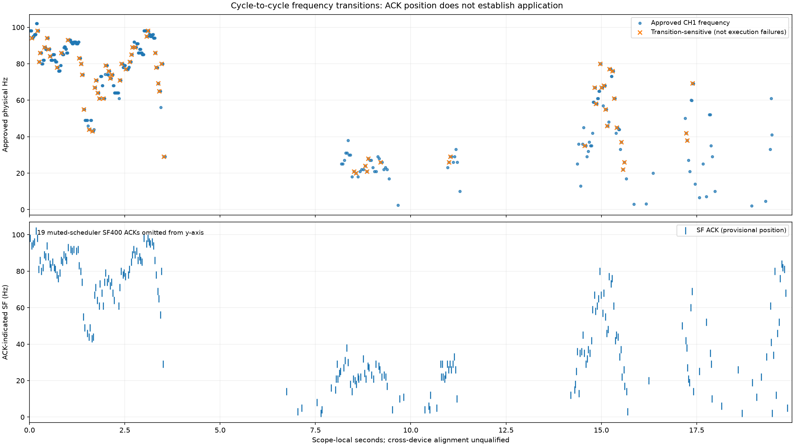

*Figure — Approved scope-local pulse frequencies alongside provisionally placed SF acknowledgments. Cross-clock event ordering is conditional on the adopted mapping.*

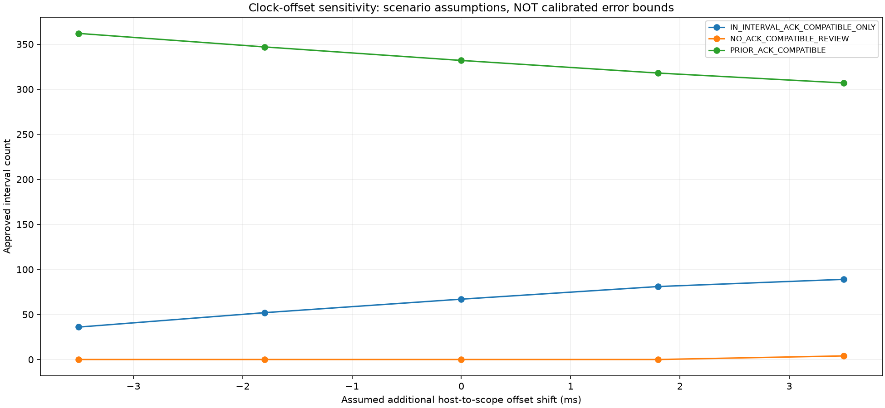

*Figure — Transition classifications under alternative assumed host-to-scope offsets. Scenarios are not calibrated confidence limits.*

Full transition report (local supporting evidence: `results/20261124T114542660847Z_integrated_hw_10M_20s_resume_check/analysis/frequency_transitions/report.md`) · Per-interval transition evidence (local supporting evidence: `results/20261124T114542660847Z_integrated_hw_10M_20s_resume_check/analysis/frequency_transitions/transitions.csv`).

## 3. Current shutdown and restart

The signed review excluded **11** negative-only events. The time association with SC0 remains provisional; a negative voltage excursion does not demonstrate current delivery, and SC0 ACK does not identify the electrical shutdown instant.

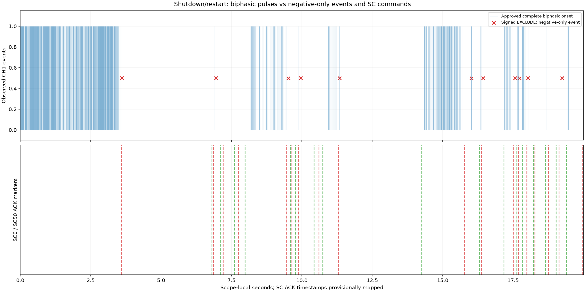

*Figure — Complete approved pulses, excluded negative-only events, and provisionally positioned SC0/SC50 acknowledgments.*

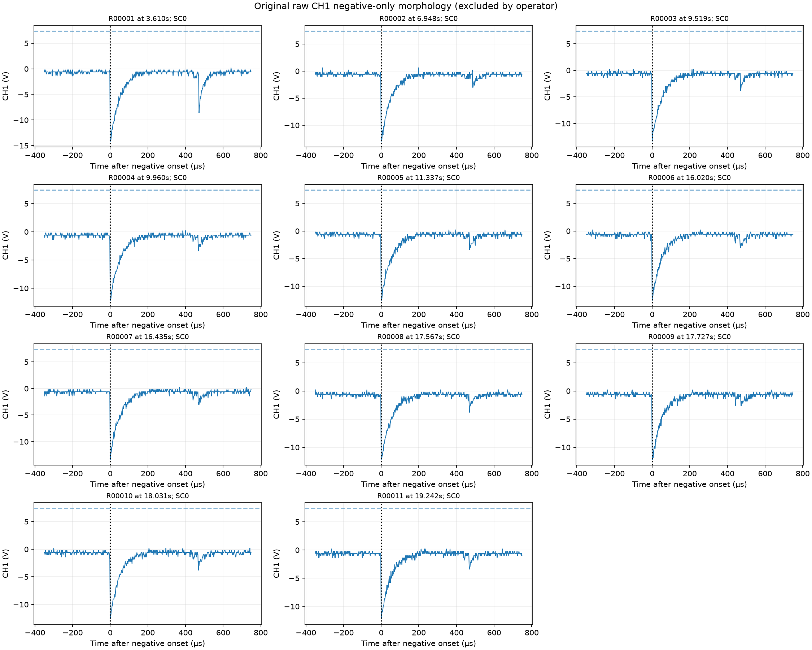

*Figure — Voltage characteristics of operator-excluded negative-only events. These are not counted as complete biphasic pulses.*

Full shutdown report (local supporting evidence: `results/20261124T114542660847Z_integrated_hw_10M_20s_resume_check/analysis/stimulation_shutdown/report.md`) · Incomplete event evidence (local supporting evidence: `results/20261124T114542660847Z_integrated_hw_10M_20s_resume_check/analysis/stimulation_shutdown/incomplete_events.csv`).

### Restart-specific analysis

| Replay transport | Restore SF ACKs | Prior matches | New local matches | Union matches | No supported pulse episodes | Median host window ms | Window < one period |
| --- | --- | --- | --- | --- | --- | --- | --- |
| baseline | 36 | 6 | 0 | 6 | 19 | 30.09 | 17 |
| shared | 45 | 2 | 0 | 2 | 28 | 8.58 | 25 |

| Classification | Baseline | Shared |
| --- | --- | --- |
| FIRST_CYCLE_UNRESOLVED | 3 | 2 |
| NEWER_SF_MATCH_POSSIBLE | 0 | 4 |
| NEWER_SF_ONLY_AT_ALL_FIRST_CYCLE_CANDIDATES | 6 | 6 |
| NO_SUPPORTED_PULSE_BEFORE_NEXT_CONTROL | 19 | 28 |
| REPLACED_BEFORE_SC_RESTORE | 2 | 3 |

Positive SF restore attempts can be replaced before the acknowledged SC restoration, or a newer SF can be the only candidate compatible with the first observable cycle. If no supported pulse occurs before the next SC write, STOP or support edge, electrical restart cannot be inferred. The first-cycle analysis relaxes only the associated SC overlap and does not automatically change chronological bounds.

### Resistor-branch transient charge

The 20 V/div repetition contains no storage-rail samples (this does not rule out analog clipping); rejected negative-only candidates number 12 and 12. For a nominal 100 kΩ resistor branch, integrate baseline-subtracted voltage divided by resistance from 100 µs before onset to the selected endpoint. Only quiet, nonoverlapping, non-rail windows enter summaries. The primary diagnostic uses 2.5 V quiet threshold and 1 ms post-onset; 4 V and 0.55/1.5 ms test sensitivity. The original 1 V quiet criterion rejected windows because of recorded baseline variation and is not used for the primary charge estimates. The negative-only finite-window net charge is negative in the candidate-group median. These are resistor-branch estimates, not total stimulator current, complete charge recovery, proof of safety, or a mechanism. The 2.5 ms spacing subset is consistent with the muted 400 Hz scheduler but does not establish causation (2 baseline, 5 shared rejected candidates within ±0.1 ms of that spacing).

| Run | Quiet threshold V | Detector group | Eligible/candidates | Q− median nC | Q+ median nC | Net median nC | Negative peak V | Positive peak V |
| --- | --- | --- | --- | --- | --- | --- | --- | --- |
| A2 | 2.5 | accepted | 389/393 | -60.265 | 62.301 | 2.016 | -36.0 | 33.6 |
| A2 | 2.5 | rejected | 12/12 | -8.166 | 2.113 | -5.988 | -12.0 | 1.6 |
| A2 | 4.0 | accepted | 392/393 | -60.271 | 62.299 | 2.012 | -36.0 | 33.6 |
| A2 | 4.0 | rejected | 12/12 | -8.166 | 2.113 | -5.988 | -12.0 | 1.6 |
| B2 | 2.5 | accepted | 401/401 | -59.785 | 62.377 | 2.608 | -36.0 | 33.6 |
| B2 | 2.5 | rejected | 12/12 | -7.801 | 2.070 | -5.556 | -12.0 | 2.4 |
| B2 | 4.0 | accepted | 401/401 | -59.785 | 62.377 | 2.608 | -36.0 | 33.6 |
| B2 | 4.0 | rejected | 12/12 | -7.801 | 2.070 | -5.556 | -12.0 | 2.4 |

| Run | Quiet V | Post-onset µs | Biphasic net median nC (n) | Negative-only net median nC (n) |
| --- | --- | --- | --- | --- |
| A2 | 2.5 | 550.0 | 1.288 (389) | -6.616 (12) |
| A2 | 2.5 | 1000.0 | 2.016 (389) | -5.988 (12) |
| A2 | 2.5 | 1500.0 | 2.680 (389) | -5.616 (12) |
| A2 | 4.0 | 550.0 | 1.284 (392) | -6.616 (12) |
| A2 | 4.0 | 1000.0 | 2.012 (392) | -5.988 (12) |
| A2 | 4.0 | 1500.0 | 2.672 (392) | -5.616 (12) |
| B2 | 2.5 | 550.0 | 2.160 (401) | -6.076 (12) |
| B2 | 2.5 | 1000.0 | 2.608 (401) | -5.556 (12) |
| B2 | 2.5 | 1500.0 | 2.992 (401) | -4.940 (12) |
| B2 | 4.0 | 550.0 | 2.160 (401) | -6.076 (12) |
| B2 | 4.0 | 1000.0 | 2.608 (401) | -5.556 (12) |
| B2 | 4.0 | 1500.0 | 2.992 (401) | -4.940 (12) |

## 4. Host command timing and cycle opportunities

Host-observed SF request-to-ACK latency median: **16.324 ms**. This is protocol completion time, NOT physical application latency.

MCU message arrival median: **14.501 ms**, SD **0.128 ms**. SF request median spacing: **42.238 ms**. These describe the full logged session; long SF gaps can be deliberate idle/muted intervals, not radio jitter.

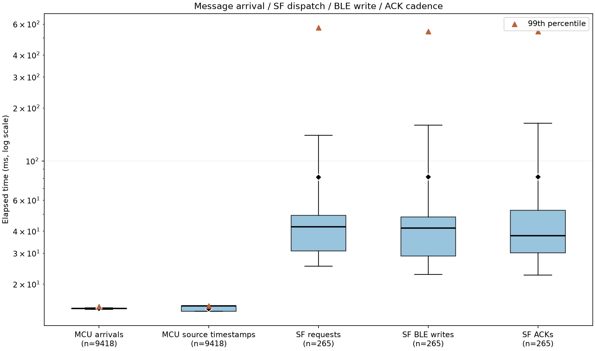

*Figure — MCU message and SF command spacing: boxes show P25–P75, lines medians, diamonds means, whiskers P05–P95, triangles P99. Times use a logarithmic axis.*

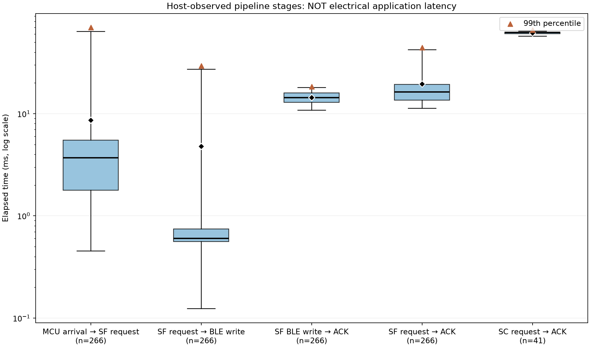

*Figure — Host-observed MCU-to-request, request-to-write, and write-to-ACK durations. Percentile and mean markers follow the other timing box plot.*

Full timing statistics and tails (local supporting evidence: `results/20261124T114542660847Z_integrated_hw_10M_20s_resume_check/analysis/command_timing/timing_distribution_statistics.csv`) · Original timing samples (local supporting evidence: `results/20261124T114542660847Z_integrated_hw_10M_20s_resume_check/analysis/command_timing/timing_distribution_samples.csv`).

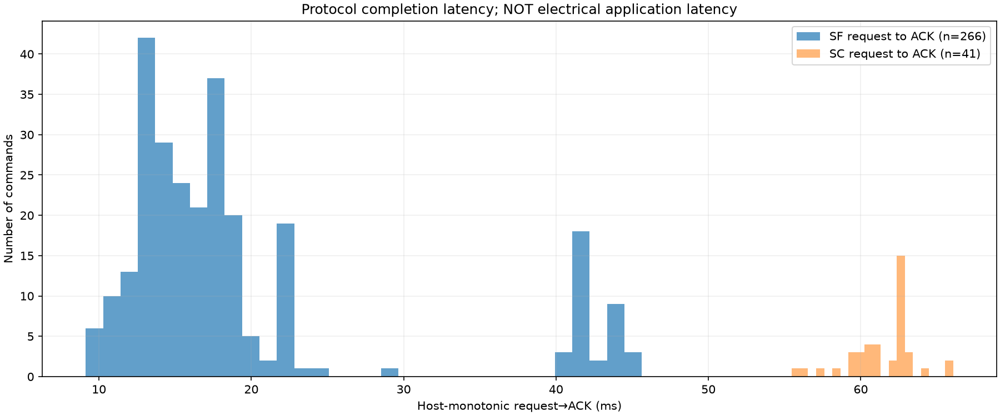

*Figure — SF and SC host-monotonic request-to-ACK durations, not measured electrical application latency.*

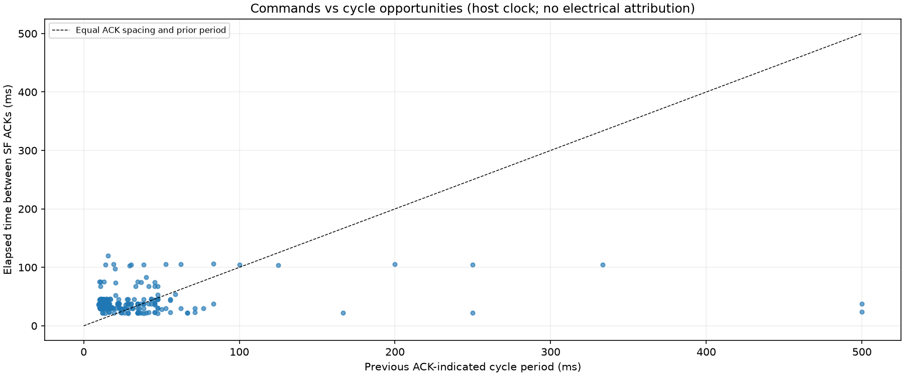

*Figure — Spacing between SF acknowledgments compared with the previous acknowledged cycle period; the diagonal indicates equal durations.*

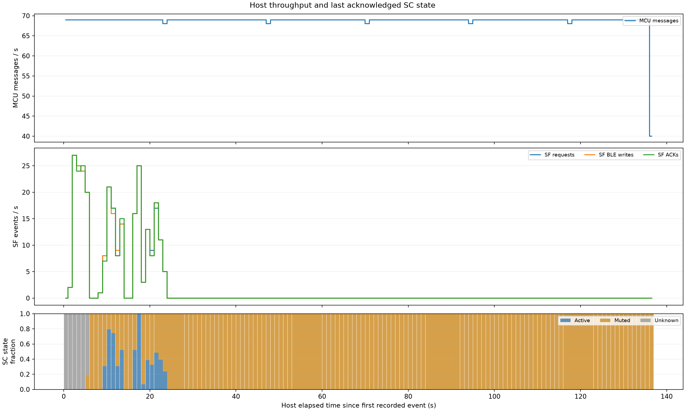

*Figure — One-second counts of MCU arrivals, SF requests, BLE writes and SF ACKs. Bottom bars give each second’s fraction in the last acknowledged SC state, including unknown time.*

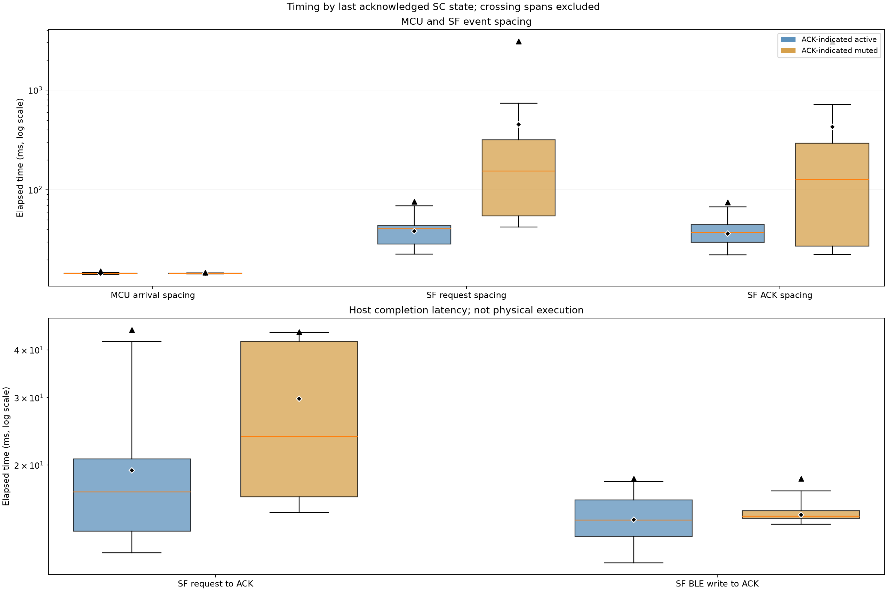

*Figure — Timing grouped by last acknowledged SC state; durations spanning an SC ACK or preceding the first SC ACK are excluded. Boxes/markers use the timing box-plot convention.*

Per-second counts (local supporting evidence: `results/20261124T114542660847Z_integrated_hw_10M_20s_resume_check/analysis/command_timing/throughput_per_second.csv`) · Per-state timing statistics (local supporting evidence: `results/20261124T114542660847Z_integrated_hw_10M_20s_resume_check/analysis/command_timing/state_timing_statistics.csv`).

Full host timing report (local supporting evidence: `results/20261124T114542660847Z_integrated_hw_10M_20s_resume_check/analysis/command_timing/report.md`) · Per-SF protocol timing (local supporting evidence: `results/20261124T114542660847Z_integrated_hw_10M_20s_resume_check/analysis/command_timing/sf_command_latency.csv`).

### Reference command chain (integer target reconstruction)

Taxel 11, sa_ii; 9419 snapshots. Controller conversion is round-half-up to integer, below 2 Hz mute, above 400 Hz clamp. Exact source-sample identity and request/terminal pairing are used; unreferenced changed targets are not failed commands.

| Coverage class | Count |
| --- | --- |
| INITIAL_OR_AFTER_AMBIGUITY | 1 |
| UNCHANGED_TARGET | 9085 |
| CHANGE_UNREFERENCED_DURING_TRANSACTION | 83 |
| CHANGE_REFERENCED_BY_REQUEST | 250 |

Stable target/ACK disagreements: 18 of 36 intervals where both states are stable. Different command-state timing is a plausible cause, not evidence of a Matrix32 frequency error.

### Controlled replay and transport comparison

Same 1414 source snapshots and 20.5 s half-open replay window in all four runs. Initial positive snapshot held until START and settling; preroll is excluded from source replay counts. Transport is the intended A/B variable; repeat CH1 scale changed for rail-free morphology.

| Run | Verified inputs | Target changes | Unreferenced changes | Measured opens | SC median ms | SF after SC median ms | SF after SF median ms | SC req→write ms | SC write→ACK ms | SF after SC req→write ms | SF after SC write→ACK ms | Replay lateness P95 ms |
| --- | --- | --- | --- | --- | --- | --- | --- | --- | --- | --- | --- | --- |
| A1 | 1414 | 266 | 34 | 70 | 61.53 | 42.49 | 14.50 | 29.51 | 29.89 | 27.33 | 14.52 | 1.264 |
| B1 | 1414 | 266 | 19 | 1 | 37.20 | 22.27 | 14.36 | 7.70 | 28.88 | 7.85 | 13.95 | 1.255 |
| A2 | 1414 | 266 | 36 | 69 | 60.63 | 44.00 | 14.16 | 29.72 | 29.94 | 29.02 | 14.80 | 1.220 |
| B2 | 1414 | 266 | 19 | 1 | 37.34 | 22.38 | 14.32 | 7.77 | 28.96 | 7.92 | 13.85 | 1.265 |

| Run | Context | OK count | Req→write median/P95 ms | Write→ACK median/P95 ms | Req→terminal median/P95 ms |
| --- | --- | --- | --- | --- | --- |
| A1 | sf | 247 | 0.52 / 29.01 | 14.06 / 17.45 | 15.47 / 44.06 |
| A1 | sc | 37 | 29.51 / 33.05 | 29.89 / 30.82 | 61.53 / 66.22 |
| A1 | sf_after_sc | 32 | 27.33 / 30.77 | 14.52 / 15.07 | 42.49 / 45.62 |
| A1 | sf_after_sf | 214 | 0.24 / 7.90 | 13.86 / 17.53 | 14.50 / 22.25 |
| B1 | sf | 263 | 0.54 / 8.10 | 13.80 / 17.53 | 14.81 / 22.45 |
| B1 | sc | 45 | 7.70 / 8.31 | 28.88 / 31.88 | 37.20 / 39.02 |
| B1 | sf_after_sc | 35 | 7.85 / 8.50 | 13.95 / 14.76 | 22.27 / 22.83 |
| B1 | sf_after_sf | 227 | 0.33 / 7.49 | 13.71 / 17.69 | 14.36 / 22.24 |
| A2 | sf | 245 | 0.16 / 29.06 | 13.86 / 16.36 | 14.30 / 44.09 |
| A2 | sc | 37 | 29.72 / 30.77 | 29.94 / 31.06 | 60.63 / 64.11 |
| A2 | sf_after_sc | 31 | 29.02 / 30.18 | 14.80 / 15.20 | 44.00 / 45.09 |
| A2 | sf_after_sf | 213 | 0.14 / 7.50 | 13.70 / 16.44 | 14.16 / 22.25 |
| B2 | sf | 263 | 0.17 / 8.27 | 13.84 / 17.39 | 14.43 / 22.50 |
| B2 | sc | 45 | 7.77 / 8.50 | 28.96 / 30.59 | 37.34 / 38.70 |
| B2 | sf_after_sc | 36 | 7.92 / 8.41 | 13.85 / 14.96 | 22.38 / 23.24 |
| B2 | sf_after_sf | 226 | 0.16 / 7.73 | 13.81 / 17.44 | 14.32 / 22.16 |

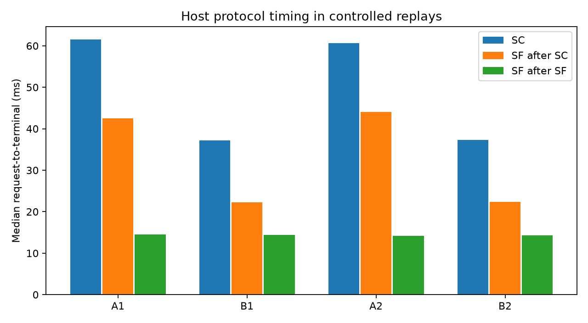

*Host request-to-terminal medians by command context for the two A/B pairs. Not physical latency.*

SC and SF-after-SC relative median reductions: A1/B1: SC 39.6%, SF after SC 47.6% and A2/B2: SC 38.4%, SF after SC 49.1%. The shared SF/SC ACK session avoids repeated subscription setup, retains mandatory ACKs, one outstanding exchange, failure poisoning and independent STOP, and extends the 7.5 ms SF guard across mixed SF/SC exchanges. Firmware, mute/resume ordering and the tactile conversion policy are not modified.

## Confidence and remaining limitations

Direct measurements: signed scope-clock periods and morphology; same-host request/write/ACK timing; replay delivery values and timing. Conditional evidence: stable target/ACK attribution, chronological distinct counts and restart candidates. Unknowns: USB asymmetry, Nano ISR delay, exact scheduler availability/application, unobserved internal boundaries, precise physical STOP and complete electrical charge balance. Neither the bench test nor the transport change is a safety qualification. Pooled counts are descriptive sums of two repeated replays per transport, not independent population statistics.

## Reproducibility

| Recording | Local evidence root |
| --- | --- |
| Reference | `results/20261124T114542660847Z_integrated_hw_10M_20s_resume_check/analysis/` |
| A1 | `results/20261126T090848918698Z_ble_ab_baseline/analysis/` |
| B1 | `results/20261126T091212099927Z_ble_ab_shared/analysis/` |
| A2 | `results/20261126T094712943788Z_ble_ab_baseline_20vdiv/analysis/` |
| B2 | `results/20261126T095023427339Z_ble_ab_shared_20vdiv/analysis/` |

Per-run modules: `timing_refinement`, `piecewise_command_analysis_integer`, `refined_ack_observability_boundaries`, `cycle_boundary_observability_chronological`, `restart_observability`. B1/B2 also contain `ble_ab_comparison`; A2/B2 contain `transient_charge_diagnostic_quiet_2p5v` and `transient_charge_diagnostic_quiet_4p0v`. The reference retains all historical extended audits and `command_chain_diagnostic`. The generated `report_revision_metrics.json` records the numerical aggregation, source fingerprints and each input summary/table hash. The approved publication is unchanged.
