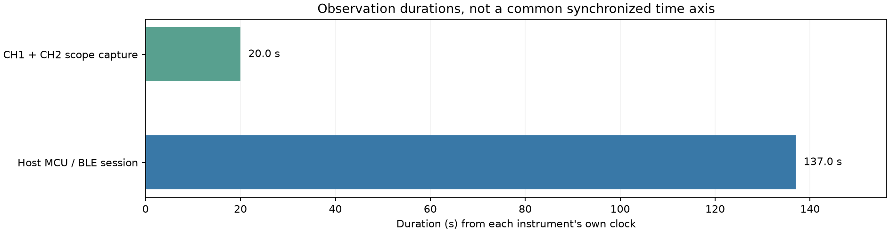
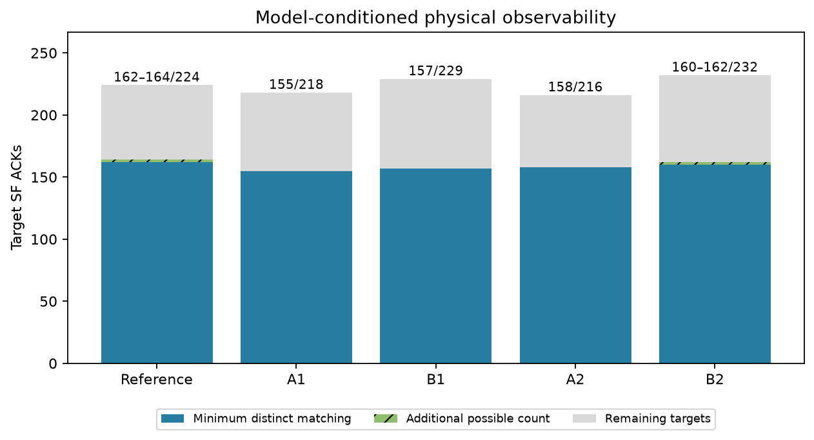
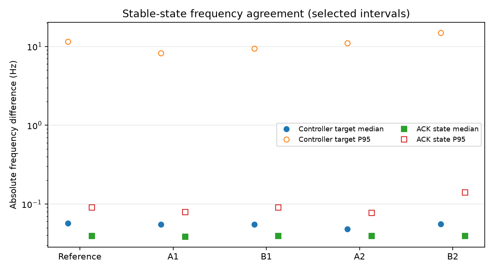
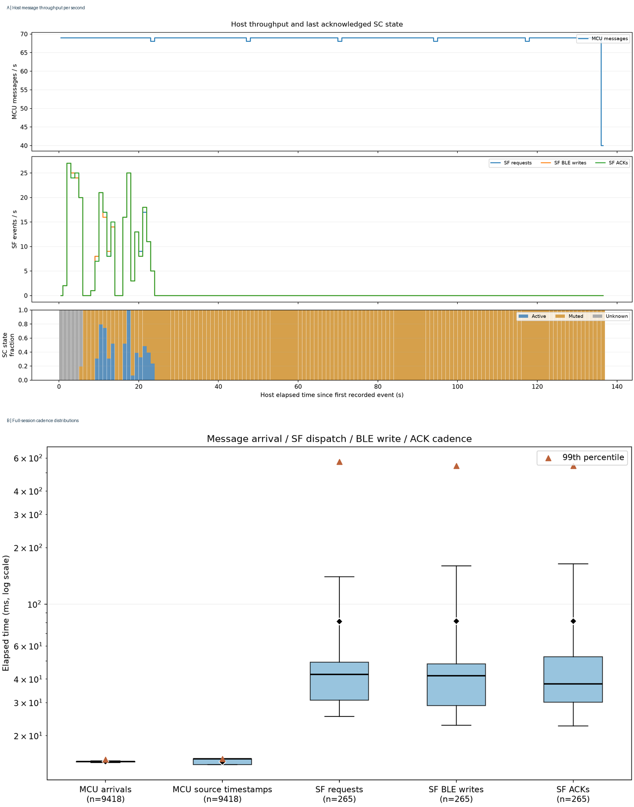
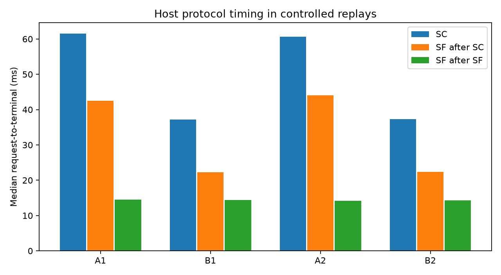
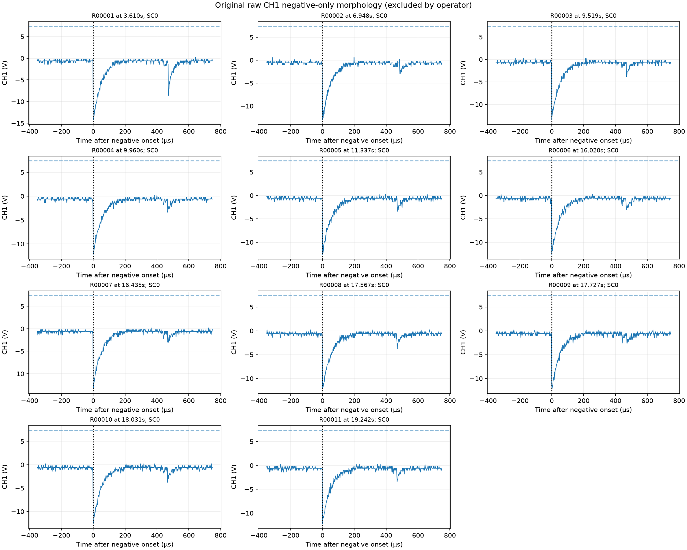

<!-- Source: results/20261124T114542660847Z_integrated_hw_10M_20s_resume_check/analysis/report_revision/final_experiment_report.md. Published snapshot; scientific numbers unmodified. -->

# Matrix32 tactile-to-electrical stimulation: consolidated experiment report

**Approved revision.** Reference recording: 24 November 2026; controlled replay validation: 26 November 2026.

> **Principal conclusion.** Across the shared replay recordings, **317–319 of 461** target SF ACKs (68.76%–69.20%) are represented in the assessed physical output under the cycle-boundary/latest-pending-SF model and chronological attribution. The corresponding baseline estimate is **313/434** (72.12%). Ordinary shared SF updates have 317/416 local matching coverage (76.20%), versus 307/398 (77.14%) for baseline. Across the four replays, 1480/1480 assessed periods match a candidate; 105 of 1585 approved intervals are not assessed. These are model-conditioned observability estimates, not independently measured device execution or failure rates.

## At a glance: research questions and evidence

| Question | Result |
| --- | --- |
| Reference SF/SC protocol delivery | 266/266 SF; 41/41 SC OK |
| Reference settled frequency | 81 selected intervals; median \|error\| 0.039 Hz |
| Shared replay physical observability | 317–319/461 under model; 745/745 assessed periods match |
| BLE transport: reduction in median request-to-terminal latency | A1/B1: SC 39.6%, SF after SC 47.6% and A2/B2: SC 38.4%, SF after SC 49.1% |
| Electrical safety | Not established; verified dummy-load bench only |

## Experiment and measurement windows

A single Tektronix record captured **CH1 electrical output across an operator-verified isolated resistive dummy load** and **CH2 Nano Every D7 timecode** at approximately **10,000,000 samples per channel** for an approximately **20-second** scope window. The MCU/controller logs span approximately **137 seconds** and contain **9,419 MCU message arrivals**. The 20-second waveform and much longer host session are different observation windows; the host-to-scope offset is **not independently qualified**. No person was connected. The controller selected tactile taxel **11** with **sa_ii** encoding.

*Figure 1 — Bars show total available host-log and scope-record durations using their respective clocks. The lengths do not indicate alignment or overlap of individual events.*

**Evidence handling.** Physical periods use consecutive onset timestamps of **418** operator-approved, positive-phase-confirmed biphasic CH1 pulses (**417** intervals). The **11** operator-excluded negative-only events remain separate diagnostics. No approved pulse, review decision, original waveform or Nano clock fit is changed by report generation.

**Operator cue schedule (host timer only):** 0 s (hold the selected taxel steady. follow the next release cue), 3 s (release the selected taxel completely), 6 s (press gently, then hold steady), 10 s (release the selected taxel completely), 13 s (press more firmly, then hold until the scope acquisition ends). Cue delivery is not proof of an operator action or of an event at that time on CH1.

The preceding original measurement description and figures concern the reference run. Four separate scope records replayed the same recorded input window; they are not additional portions of the original host session.

| Label | Recording ID | Approved pulses | Intervals | Excluded negative-only | SF OK/requested | SC OK/requested |
| --- | --- | --- | --- | --- | --- | --- |
| Reference | 20261124T114542660847Z_integrated_hw_10M_20s_resume_check | 418 | 417 | 11 | 266/266 | 41/41 |
| A1 | 20261126T090848918698Z_ble_ab_baseline | 400 | 399 | 11 | 247/247 | 37/37 |
| B1 | 20261126T091212099927Z_ble_ab_shared | 395 | 394 | 12 | 263/263 | 45/45 |
| A2 | 20261126T094712943788Z_ble_ab_baseline_20vdiv | 393 | 392 | 12 | 245/245 | 37/37 |
| B2 | 20261126T095023427339Z_ble_ab_shared_20vdiv | 401 | 400 | 12 | 263/263 | 45/45 |

Replay input: 1414 snapshots over 20.5 s, identical verified source values and schedule. The first pair used 10 V/div and the second 20 V/div on CH1. Each run is a separate dummy-load recording.

## 1. Frequency requests and physical observability

| Run | SF OK ACKs | Muted inside | Outside/edge | Target ACKs inside support | Unique local | Distinct chronological | Chronological coverage | Matching/assessed cycles |
| --- | --- | --- | --- | --- | --- | --- | --- | --- |
| Reference | 266 | 18 | 24 | 224 | 123 | 162–164 | 72.32%–73.21% | 386/386 |
| A1 | 247 | 19 | 10 | 218 | 118 | 155 | 71.10% | 367/367 |
| B1 | 263 | 24 | 10 | 229 | 107 | 157 | 68.56% | 368/368 |
| A2 | 245 | 19 | 10 | 216 | 129 | 158 | 73.15% | 368/368 |
| B2 | 263 | 23 | 8 | 232 | 117 | 160–162 | 68.97%–69.83% | 377/377 |
| Replay baseline pooled | 492 | 38 | 20 | 434 | 247 | 313 | 72.12% | 735/735 |
| Replay shared pooled | 526 | 47 | 18 | 461 | 224 | 317–319 | 68.76%–69.20% | 745/745 |

*Figure 2 — Target ACKs counted once; solid bars show the lower chronological count, hatched extension the optional count, and remaining targets lack a selected matching witness. This is not a success/failure rate.*

A frequency selection is modeled at an approved negative pulse onset for the following cycle. Latest available SF wins; a subsequent SF within that cycle does not invalidate the period. Availability is assumed between host BLE write begin and embedded ACK receipt; the ACK does not establish the internal application instant. Candidate identities are enumerated independently of frequency error and constrained to nondecreasing chronological order. Each distinct live target ACK is counted once; repeated numeric values remain different command identities. The target denominator is successful SF ACKs with trace ACK inside Gray support, excluding muted-scheduler SF400 but including restore SF attempts. Initial START frequency is context, not a live SF ACK. SC transitions, unsupported boundaries and long pauses (>0.5 s) are excluded from primary cycle attribution. Matching tolerance is max(1 Hz, 2.5%); tighter tolerances and 1×/2×/3× timing margins are sensitivity tests. A path through individual boundary envelopes is not proof that one jointly feasible clock realization or one exact firmware history produced every period.

| Replay transport | SF purpose | Target ACKs | Local matches | Local coverage | Required on all paths | Optional on paths |
| --- | --- | --- | --- | --- | --- | --- |
| baseline | ordinary | 398 | 307 | 77.14% | 307 | 0 |
| baseline | restore | 36 | 6 | 16.67% | 6 | 0 |
| shared | ordinary | 416 | 317 | 76.20% | 315 | 2 |
| shared | restore | 45 | 2 | 4.44% | 2 | 0 |

## 2. Settled-state electrical frequency agreement

The previously approved affine-map analysis reported 85 selected intervals (median 0.039 Hz; P95 0.094 Hz; max 0.155 Hz). That is retained as a historical result, not pooled with the refined analysis. The revised calculation uses actual integer controller targets and stable ACK states within the piecewise/USB envelopes.

| Run | Stable reference | Eligible/all intervals | Median \|error\| Hz | P95 Hz | Max Hz |
| --- | --- | --- | --- | --- | --- |
| Reference | Integer controller target | 190/417 | 0.057 | 11.545 | 55.061 |
| Reference | ACK-indicated SF | 81/417 | 0.039 | 0.090 | 0.137 |
| A1 | Integer controller target | 176/399 | 0.055 | 8.255 | 51.051 |
| A1 | ACK-indicated SF | 77/399 | 0.038 | 0.079 | 0.207 |
| B1 | Integer controller target | 177/394 | 0.055 | 9.427 | 55.061 |
| B1 | ACK-indicated SF | 86/394 | 0.039 | 0.091 | 0.407 |
| A2 | Integer controller target | 174/392 | 0.048 | 10.984 | 39.007 |
| A2 | ACK-indicated SF | 74/392 | 0.039 | 0.077 | 0.269 |
| B2 | Integer controller target | 177/400 | 0.056 | 14.978 | 55.061 |
| B2 | ACK-indicated SF | 83/400 | 0.039 | 0.141 | 0.391 |

*Figure 3 — Absolute frequency differences in eligible subsets only; median and P95 are shown separately for integer controller target and acknowledged SF. The subset sizes differ.*

The controller-target and ACK subsets differ. A target error includes tracking delay and supersession, not necessarily inaccurate physical frequency generation.

## 3. Rapid frequency updates and timing uncertainty

CH1 and CH2 share the scope clock. Hardware-timed Nano Gray START edges are logged by an ISR; its timestamp latency is not calibrated. Scope-to-Nano piecewise interpolation is evaluated by blocked held-out anchors, not selected by frequency agreement. Nano-to-PC four-timestamp USB exchanges constrain an affine slope/offset envelope without assuming symmetric USB transport. Widening by held-out Gray P95 is heuristic. No extrapolation outside Gray anchors is allowed. Local rate deviation still exceeds the 250 ppm qualification criterion; absolute cross-clock error and physical application latency remain uncalibrated. Physical periods themselves use only the scope clock.

Reference and replay results are separately computed from signed physical periods. The four-replay primary chronological estimates are 313 baseline and 317–319 shared; see the detailed report for all timing/tolerance scenarios and unmatched categories.

## 4. Host scheduling and BLE communication

The MCU-to-host stream contains **9,419** messages at **14.501 ms median** inter-arrival spacing, with SD **0.128 ms**. SF requests have a **42.238 ms** median spacing, and SF request-to-ACK completion has **16.324 ms** median latency. The 95th percentile of SF request-to-BLE-write delay is **27.251 ms**, compared with **18.091 ms** for BLE-write-to-ACK. Inter-request gaps reflect controller decisions and muted intervals, **not radio jitter**. All request/ACK timing is measured on the same PC clock and does not quantify electrical application latency.

*Figure 4 — Panel A: per-second MCU arrivals, SF host requests, BLE writes and ACKs with ACK-indicated current state. Panel B: box-and-whisker distributions of the corresponding full-session message cadences. Long command-free gaps are included; source state and host timing are not electrical output measurements.*

Detailed timing distributions (local supporting evidence: `results/20261124T114542660847Z_integrated_hw_10M_20s_resume_check/analysis/command_timing/report.md`) | State-separated timing (local supporting evidence: `results/20261124T114542660847Z_integrated_hw_10M_20s_resume_check/analysis/command_timing/state_timing_statistics.csv`) | Per-second throughput (local supporting evidence: `results/20261124T114542660847Z_integrated_hw_10M_20s_resume_check/analysis/command_timing/throughput_per_second.csv`)

The preceding host-cadence result is from the original reference session. In the controlled paired replays, actual input values/schedule are verified; changed target selection and output are outcomes, not fixed command streams.

| Run | Verified inputs | Target changes | Unreferenced changes | Measured opens | SC median ms | SF after SC median ms | SF after SF median ms |
| --- | --- | --- | --- | --- | --- | --- | --- |
| A1 | 1414 | 266 | 34 | 70 | 61.53 | 42.49 | 14.50 |
| B1 | 1414 | 266 | 19 | 1 | 37.20 | 22.27 | 14.36 |
| A2 | 1414 | 266 | 36 | 69 | 60.63 | 44.00 | 14.16 |
| B2 | 1414 | 266 | 19 | 1 | 37.34 | 22.38 | 14.32 |

*Figure 5 — Median request-to-trace-terminal durations for matched replay conditions; latency is host protocol timing, not electrical application.*

The shared implementation reduces subscription overhead and is now the sole live SF/SC transport. The existing 7.5 ms SF guard is retained and applied across the shared SF/SC session; zero-current mute ordering remains unchanged; no firmware change was made. The ordinary-frequency local matching coverage is similar in these two descriptive repetitions; no statistical equivalence or noninferiority claim is made.

## 5. Current shutdown, restart and incomplete waveforms

The signed inventory excludes **11** negative-only voltage events. Under the nominal mapping, **11** occur after the latest SC0 ACK. Their morphology is directly observed, but SC0 timing is only provisionally associated and does not establish an electrical cutoff time or voltage-transient mechanism.

*Figure 6 — Operator-excluded negative-only CH1 voltage events. Each lacks the required positive-phase confirmation and contributes neither an approved biphasic pulse nor a measured stimulation period.*

Current-transition analysis (local supporting evidence: `results/20261124T114542660847Z_integrated_hw_10M_20s_resume_check/analysis/stimulation_shutdown/report.md`) | Source event details (local supporting evidence: `results/20261124T114542660847Z_integrated_hw_10M_20s_resume_check/analysis/stimulation_shutdown/incomplete_events.csv`)

| Replay transport | Restore SF ACKs | Prior matches | New local matches | Union matches | No supported pulse episodes | Median host window ms | Window < one period |
| --- | --- | --- | --- | --- | --- | --- | --- |
| baseline | 36 | 6 | 0 | 6 | 19 | 30.09 | 17 |
| shared | 45 | 2 | 0 | 2 | 28 | 8.58 | 25 |

First-pulse alternatives are conditional on SC availability; they may include residual pulses. The reported host window is not a measured current-on duration. Local restart matches are not added to chronological counts without joint attribution.

The 20 V/div repetition contains no storage-rail samples (this does not rule out analog clipping); rejected negative-only candidates number 12 and 12. For a nominal 100 kΩ resistor branch, integrate baseline-subtracted voltage divided by resistance from 100 µs before onset to the selected endpoint. Only quiet, nonoverlapping, non-rail windows enter summaries. The primary diagnostic uses 2.5 V quiet threshold and 1 ms post-onset; 4 V and 0.55/1.5 ms test sensitivity. The original 1 V quiet criterion rejected windows because of recorded baseline variation and is not used for the primary charge estimates. The negative-only finite-window net charge is negative in the candidate-group median. These are resistor-branch estimates, not total stimulator current, complete charge recovery, proof of safety, or a mechanism. The 2.5 ms spacing subset is consistent with the muted 400 Hz scheduler but does not establish causation (2 baseline, 5 shared rejected candidates within ±0.1 ms of that spacing).

| Run | Quiet threshold V | Detector group | Eligible/candidates | Q− median nC | Q+ median nC | Net median nC | Negative peak V | Positive peak V |
| --- | --- | --- | --- | --- | --- | --- | --- | --- |
| A2 | 2.5 | accepted | 389/393 | -60.265 | 62.301 | 2.016 | -36.0 | 33.6 |
| A2 | 2.5 | rejected | 12/12 | -8.166 | 2.113 | -5.988 | -12.0 | 1.6 |
| A2 | 4.0 | accepted | 392/393 | -60.271 | 62.299 | 2.012 | -36.0 | 33.6 |
| A2 | 4.0 | rejected | 12/12 | -8.166 | 2.113 | -5.988 | -12.0 | 1.6 |
| B2 | 2.5 | accepted | 401/401 | -59.785 | 62.377 | 2.608 | -36.0 | 33.6 |
| B2 | 2.5 | rejected | 12/12 | -7.801 | 2.070 | -5.556 | -12.0 | 2.4 |
| B2 | 4.0 | accepted | 401/401 | -59.785 | 62.377 | 2.608 | -36.0 | 33.6 |
| B2 | 4.0 | rejected | 12/12 | -7.801 | 2.070 | -5.556 | -12.0 | 2.4 |

## Conclusions and remaining questions

Across the shared replay recordings, **317–319 of 461** target SF ACKs (68.76%–69.20%) are represented in the assessed physical output under the cycle-boundary/latest-pending-SF model and chronological attribution. The corresponding baseline estimate is **313/434** (72.12%). Ordinary shared SF updates have 317/416 local matching coverage (76.20%), versus 307/398 (77.14%) for baseline. Across the four replays, 1480/1480 assessed periods match a candidate; 105 of 1585 approved intervals are not assessed. These are model-conditioned observability estimates, not independently measured device execution or failure rates.

The shared persistent session is supported for the verified dummy-load research setup. Insufficient observation time and current transitions limit attribution, and some commands are consistent with between-cycle replacement. Many unmatched commands remain unresolved; an unmatched ACK is not evidence of a failed command. Exact physical application latency, internally superseded command identities, complete current/charge balance and safety remain unproven. The present model-conditioned estimates can be reported without another acquisition.

## Detailed evidence, limitations and reproducibility

[Detailed technical consolidation](extended_analysis_technical_report.md).

| Recording | Local evidence root |
| --- | --- |
| Reference | `results/20261124T114542660847Z_integrated_hw_10M_20s_resume_check/analysis/` |
| A1 | `results/20261126T090848918698Z_ble_ab_baseline/analysis/` |
| B1 | `results/20261126T091212099927Z_ble_ab_shared/analysis/` |
| A2 | `results/20261126T094712943788Z_ble_ab_baseline_20vdiv/analysis/` |
| B2 | `results/20261126T095023427339Z_ble_ab_shared_20vdiv/analysis/` |

Per-run modules: `timing_refinement`, `piecewise_command_analysis_integer`, `refined_ack_observability_boundaries`, `cycle_boundary_observability_chronological`, `restart_observability`. B1/B2 also contain `ble_ab_comparison`; A2/B2 contain `transient_charge_diagnostic_quiet_2p5v` and `transient_charge_diagnostic_quiet_4p0v`. The reference retains all historical extended audits and `command_chain_diagnostic`. The generated `report_revision_metrics.json` records the numerical aggregation, source fingerprints and each input summary/table hash. The approved publication is unchanged.
